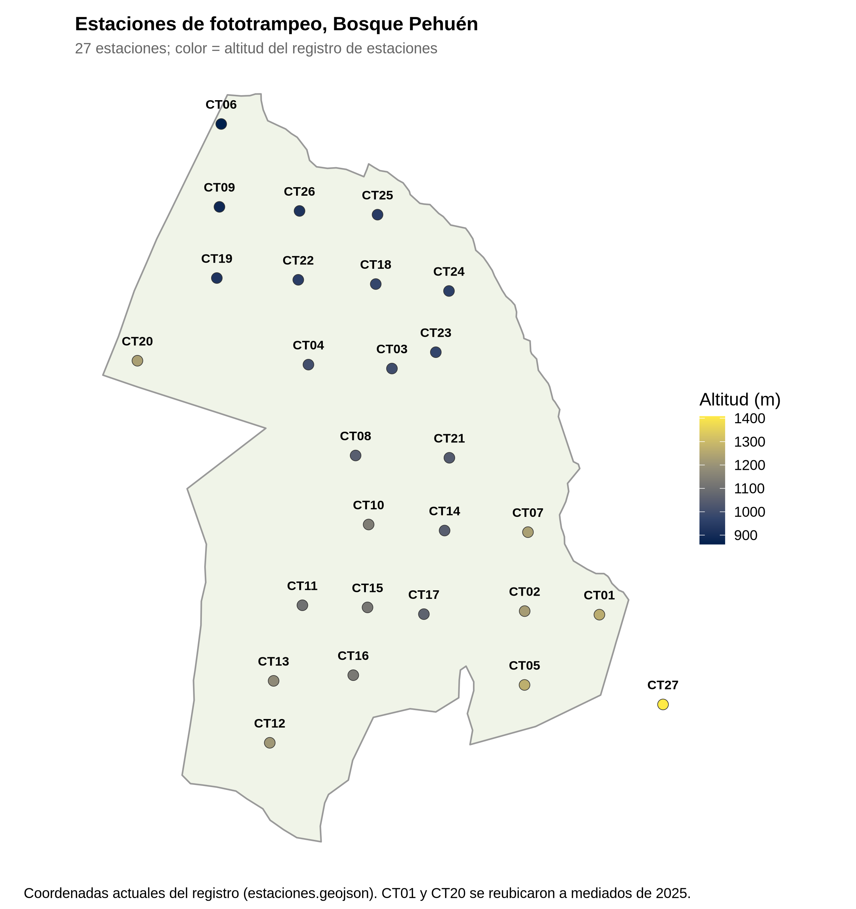
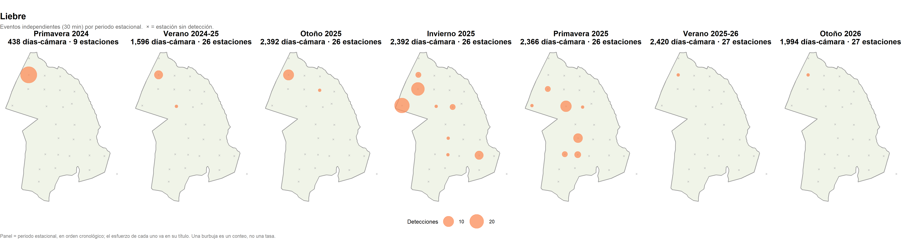
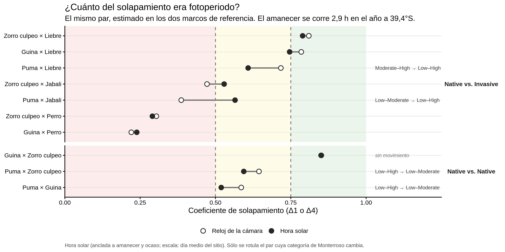

# Resumen

Llevamos 19 meses de registro continuo de 27 cámaras trampa. De ellos salen **380 eventos
independientes** de seis especies focales: tres carnívoros nativos (puma, güiña, zorro culpeo)
y tres invasoras (jabalí, liebre, perro).

El resultado más sólido hasta ahora es temporal. **Los nativos coinciden poco en el horario con
el perro**: el culpeo y la güiña son nocturnos y el perro es estrictamente diurno. Esto se
sostiene con los dos marcos de tiempo que usamos. Todavía no sabemos si es evitación o solo
el horario propio del perro.

El hallazgo que más pide explicación es la **liebre**. Era la segunda especie más registrada.
Desde diciembre de 2025 prácticamente desaparece de todo el arreglo, en cámaras que siguen
funcionando y registrando otros animales. Parte de la comparación entre años está afectada
por cambios en la instalación de las cámaras (sección 4.1), pero la caída simultánea en todas
las estaciones no se explica por eso.

Lo espacial sigue siendo mayormente descriptivo. El análisis conjunto de espacio y tiempo, es
decir, si una especie evita los lugares que otra acaba de usar, todavía no se ha hecho.

---

# 1. Los datos

## 1.1 El arreglo de cámaras

Hay **27 estaciones (CT01–CT27)** entre 861 y 1.408 m de altitud. Las estaciones de
menor altitud están en el norte de la reserva (CT06, CT09, CT19) y las más altas en el sureste
(CT01, CT05, CT27). CT27 se instaló en diciembre de 2025 y queda fuera del polígono de la
reserva. CT01 y CT20 se reubicaron a mediados de 2025. El mapa muestra su posición actual.

## 1.2 Período y esfuerzo de muestreo

El registro va del **9 de octubre de 2024 al 15 de mayo de 2026**. Las tarjetas se retiraron
en tres campañas de terreno (otoño 2025, primavera 2025, otoño 2026). Cada campaña cubre el
intervalo entre dos visitas y mezcla varias estaciones del año. Por eso todo el análisis se
ordena por **temporada**, calculada desde la fecha de cada foto, y no por campaña. Así quedan
siete temporadas, con dos otoños, dos primaveras y dos veranos. Eso permite preguntar si un
patrón se repite.

El arreglo creció con el tiempo. En primavera de 2024 había 9 cámaras; desde el verano
2025-26 hay 27. El esfuerzo total es de **13.598 días-cámara**. De esos, **10.912** son útiles
para calcular tasas, porque tienen fotos con un reloj confiable:

| Temporada | Días-cámara útiles | Estaciones muestreando |
|---|---:|---:|
| Primavera 2024 | 292 | 9 |
| Verano 2024-25 | 1.072 | 25 |
| Otoño 2025 | 1.387 | 25 |
| Invierno 2025 | 1.985 | 26 |
| Primavera 2025 | 2.008 | 26 |
| Verano 2025-26 | 2.249 | 27 |
| Otoño 2026 | 1.919 | 27 |

La figura siguiente muestra cada despliegue (el período entre dos visitas) por estación.
Explica de una vez por qué el esfuerzo es desigual y de dónde vienen las fotos sin hora
utilizable (sección 2).

Hubo 79 despliegues. 74 produjeron fotos. 4 grabaron solo video (CT22, CT24, CT25 y CT26,
primer período), que hoy queda fuera del flujo de análisis, y 1 tarjeta falló (CT21).

## 1.3 Qué contienen las 35.807 imágenes

| Contenido | Imágenes | % |
|---|---:|---:|
| Vacías (disparos sin animal) | 31.090 | 86,8 |
| Personas | 1.424 | 4,0 |
| Vehículos | 250 | 0,7 |
| No identificables | 521 | 1,5 |
| **Animales** | **2.522** | **7,0** |

Todas las imágenes con animal fueron revisadas por una persona: 1.447 se confirmaron y 1.912
se corrigieron. El animal más fotografiado es el **vacuno** (579 imágenes), seguido de liebre
(389) y zorro culpeo (335). También aparecen especies que no son focales en este análisis pero
son relevantes: **ciervo rojo** (87, invasor), caballo (123), monito del monte (55) y pudú (31).

**La unidad de análisis es el evento independiente, no la foto.** Una cámara toma 2–3 fotos
por disparo, y un animal que se queda frente a ella genera muchas. Por eso se agrupan las
fotos de una misma especie en una misma estación separadas por menos de 30 minutos. Ejemplo:
las 579 fotos de vacuno son solo 19 eventos.

| Especie | Eventos independientes |
|---|---:|
| Zorro culpeo | 161 |
| Liebre | 129 |
| Perro | 46 |
| Jabalí | 18 |
| Güiña | 14 |
| Puma | 12 |

**Los registros están concentrados.** CT03 y CT09 reúnen el 37 % de todos los eventos. 56 de
los 161 eventos del culpeo están en CT03. Cuatro estaciones nunca registraron una especie
focal con hora válida.

---

# 2. Imágenes con uso limitado

Hay que distinguir dos niveles. Las imágenes sin animal no sirven para este estudio. Pero
dentro de las imágenes con animal hay un segundo grupo: aquellas cuya **cámara tenía el reloj
dañado**. Esas fotos prueban que el animal estuvo en esa estación, pero no cuándo. Sirven para
los mapas de presencia y no sirven para nada que use fecha u hora: actividad diaria,
temporadas, tasas o solapamiento.

De las 2.522 imágenes con animal, **452 (18 %)** no tienen una hora confiable. Entre las seis
especies focales son **258 de 1.112 (23 %)**, pero la pérdida es desigual:

| Especie | Imágenes con solo lugar | Total imágenes | % |
|---|---:|---:|---:|
| Jabalí | 64 | 149 | 43 |
| Puma | 19 | 46 | 41 |
| Liebre | 88 | 389 | 23 |
| Zorro culpeo | 70 | 335 | 21 |
| Güiña | 5 | 29 | 17 |
| Perro | 12 | 164 | 7 |

Las dos especies con menos registros, puma y jabalí, son también las que más información
horaria pierden.

## 2.1 De dónde vienen las imágenes de puma y jabalí sin hora

Todas vienen de **tres despliegues**. En los tres, la cámara funcionó todo el período pero su
reloj no se pudo reconstruir. Ninguna de esas 83 imágenes tiene fecha:

| Despliegue | Puma | Jabalí | Problema del reloj |
|---|---:|---:|---|
| CT10, oct 2024 – may 2025 | 11 | 30 | Reloj coherente pero sin punto de referencia |
| CT15, ene – jun 2025 | 6 | 1 | Reloj coherente pero sin punto de referencia |
| CT18, nov 2025 – may 2026 | 2 | 33 | Jabalí: registro del reloj corrupto. Puma: sin punto de referencia |

Los dos problemas son distintos:

- **Reloj coherente sin punto de referencia** (CT10, CT15 y los 2 pumas de CT18). El reloj
  avanzó de forma pareja, pero en algún momento se desconfiguró (por ejemplo, al cambiar
  baterías) y quedó con una fecha equivocada. Para corregirlo se necesita al menos un
  **testigo**: una foto cuya hora real se conozca, como la de una persona del equipo en una
  visita registrada. Sin testigo dentro de ese tramo no se puede saber cuánto corregir.
  **Es recuperable** si aparece evidencia de terreno.
- **Registro del reloj corrupto** (los 33 jabalíes de CT18). La fecha que la cámara escribe en
  el nombre de cada archivo no coincide con la fecha guardada dentro de la imagen. El reloj no
  estaba solo desplazado; su registro es internamente contradictorio. **No es recuperable**:
  no hay una única corrección que lo arregle.

**Qué significa para el análisis.** CT10 y CT18 están entre los cuatro sitios con más fotos
de jabalí (los otros son CT13 y CT11). Por eso la curva de actividad del jabalí y sus
solapamientos se calculan casi sin dos de sus cuatro sitios principales. CT10 desaparece por
completo de los análisis temporales del jabalí, y de CT18 quedan solo 2 fotos.

El puma figura en 8 estaciones en el mapa de presencia y en 7 en los análisis con hora; se
pierde CT18. En CT10 y CT15 se pierden sus registros de octubre de 2024 a junio de 2025, que
son los únicos de puma en esas estaciones durante ese verano y otoño. Esto importa para la
sección 3: **algunas de esas 17 fotos sin fecha podrían ser de otoño de 2025**, la temporada
en la que el puma aparece sin registros.

Sin hora no se pueden agrupar esas fotos en eventos, así que no se sabe exactamente cuántos
eventos se pierden. Como referencia, a 2–3 fotos por disparo, 64 fotos de jabalí son del
orden de 20–30 disparos. Los eventos serían menos.

Hay un caso equivalente para la liebre: **65 fotos en CT19 entre febrero y junio de 2025**,
con el reloj pendiente de un testigo. Si se encuentra uno, esas fotos se recuperan.

---

# 3. Lo más básico: dónde están las especies y con qué frecuencia

La primera capa de análisis es descriptiva:

- mapas de presencia y ausencia por especie y de riqueza por estación;
- mapas de burbujas con el número de eventos por estación;
- para cada temporada, la **tasa de detección** (eventos por 100 días-cámara) y la
  **ocupación ingenua** (proporción de estaciones donde la especie se vio al menos una vez).

**Zorro culpeo** es el fondo estable del registro. Su tasa está cerca de 1–2 eventos por 100
días-cámara en todas las temporadas, y aparece en el 20–44 % de las estaciones cada temporada.

**Perro** alcanza su máximo en el verano 2025-26: 0,62 eventos por 100 días-cámara, en 5
estaciones. Sus registros se concentran en CT09 (14 eventos) y CT03 (9).

**Puma** no tiene eventos con fecha en ninguna temporada de otoño o invierno. Con 12 eventos
en total esto es una descripción, no un resultado. Además, 17 fotos de puma sin fecha (CT10 y
CT15) podrían caer en el otoño de 2025 (sección 2.1).

**Güiña y jabalí** tienen 14 y 18 eventos. Como ya se dijo, al jabalí le faltan dos de sus
cuatro sitios principales en todo lo que usa la hora.

## 3.1 Hallazgo destacado: la liebre desaparece del arreglo desde diciembre de 2025

> **Este resultado pide una explicación biológica.** Los datos se revisaron dos veces y los
> conteos se sostienen. Una parte de la comparación entre años está afectada por cambios en
> la instalación de las cámaras, y eso se detalla abajo. Pero la desaparición simultánea en
> todas las estaciones donde la liebre estaba no se explica por esos cambios.

**Lo que muestran los datos.** Eventos de liebre por temporada, en las estaciones donde
aparece:

| Estación | Prim 2024 | Ver 24-25 | Oto 2025 | Inv 2025 | Prim 2025 | Ver 25-26 | Oto 2026 |
|---|---:|---:|---:|---:|---:|---:|---:|
| CT09 | 29 | 6 | 10 | 2 | 0 | 1 | 1 |
| CT20 | — | 0 | 0 | 23 | 1 | 0 | 0 |
| CT19 | — | *s/h* | *s/h* | 17 | 2 | 0 | 0 |
| CT04 | 0 | 1 | 0 | 1 | 11 | 0 | 0 |
| CT10 | *s/h* | *s/h* | *s/h* | 1 | 7 | 0 | 0 |
| CT02, CT03, CT11, CT15, CT18 | 0 | 0 | 1 | 9 | 6 | 0 | 0 |
| **Total** | **29** | **7** | **11** | **53** | **27** | **1** | **1** |
| **Por 100 días-cámara** | 9,93 | 0,65 | 0,79 | 2,67 | 1,34 | **0,04** | **0,05** |

*s/h: la cámara funcionaba pero sin reloj utilizable. —: la estación aún no estaba instalada.*

Entre los dos otoños la tasa cae de 0,79 a 0,05, unas 16 veces. Los tres eventos de
noviembre de 2025 son los últimos en esas estaciones, salvo dos en CT09 (enero y abril
de 2026).

**Lo que se verificó y descartó como artefacto:**

- **Las cámaras funcionaban.** CT09, CT19 y CT20 operaron con reloj válido durante todo el
  verano 2025-26 y el otoño 2026 (figura de la sección 1.2). Siguieron registrando otros
  animales: CT19 registró caballo (39 fotos) y aves que caminan por el suelo, como chucao y
  hued-hued; CT20 registró ciervo rojo y CT09 perros. Una cámara que registra un chucao
  puede registrar una liebre.
- **No está oculta entre las fotos sin identificar.** Las 398 imágenes no identificables del
  otoño 2026 se concentran en CT08 (167) y CT22 (118). En ninguna de las dos estaciones se ha
  registrado nunca una liebre.
- **No está oculta por relojes dañados.** En la última campaña solo hay 12 fotos de liebre sin
  fecha, todas en CT18. Equivalen como mucho a unos pocos eventos.
- **No es un error de identificación.** Todas las fotos de animales fueron revisadas por una
  persona, y solo hay un registro de conejo en todo el período (CT04, enero de 2025).

**Lo que sí afecta la comparación entre años.** Las notas de terreno registran tres cambios
de instalación, justo en las estaciones donde estaba la liebre:

- **CT09**: cámara elevada a unos 2 m el 14 de mayo de 2025.
- **CT19**: cámara elevada a unos 2 m el 5 de junio de 2025.
- **CT20**: reubicada a un punto abierto junto al sendero el 9 de junio de 2025.

CT09 llevaba casi toda la liebre del verano y el otoño de 2025 (45 de sus 49 eventos fueron
antes de elevarla). Después de elevarla, sus fotos de animales cayeron de 183 a 9 y 8 por
campaña. Por eso **la comparación verano con verano y otoño con otoño compara en gran parte a
CT09 a ras de suelo con CT09 a 2 m**. Esa caída de 16 veces no puede atribuirse por completo
a la liebre.

**Lo que se sostiene a pesar de eso.** CT19 y CT20 ya estaban en su nueva configuración cuando
registraron 43 eventos de liebre entre junio y octubre de 2025. En la primavera de 2025 la
liebre además se extendió a CT02, CT04, CT10, CT11 y CT15. Desde diciembre de 2025 **todas esas
estaciones quedan en silencio al mismo tiempo**, con la misma instalación (hasta donde se
registró) y registrando otras especies.

**Dos explicaciones posibles**, que hoy no se pueden distinguir:

1. **Patrón estacional.** La liebre usa estos sitios de bosque y borde en invierno y primavera
   y se desplaza en verano y otoño, por ejemplo hacia praderas abiertas fuera del arreglo. El
   cambio de altura de CT09 impide comparar con el verano anterior.
2. **Disminución real de la población** por enfermedad, depredación, control o caza, u otra
   causa. Vale la pena preguntar a los guardaparques si hubo controles o hallazgos de
   animales muertos.

**Cómo distinguirlas.** Hay dos pasos concretos:

- **Confirmar con el equipo de terreno que en la visita de noviembre–diciembre de 2025 no se
  movió ni se reorientó ninguna cámara.** Esa visita no tiene notas en el registro de terreno.
- **Esperar el invierno y la primavera de 2026.** Si la liebre vuelve a CT19, CT20, CT04 y
  CT10 entre junio y octubre de 2026, el patrón es estacional. Si no vuelve, es una
  disminución.

Hay que tener en cuenta que en la visita de mayo de 2026 **todas las cámaras se elevaron a
1,5–2 m**. Esa comparación tendrá entonces la misma limitación que CT09, ahora en todo el
arreglo.

---

# 4. Separar "ausente" de "no detectado": ocupación

Que una especie no aparezca en una cámara no prueba que no use ese lugar. Puede haber pasado
sin ser fotografiada. Los modelos de ocupación separan dos cosas: la proporción de sitios que
la especie realmente usa (**ψ**) y la probabilidad de detectarla cuando está (**p**).

Para eso se construyó, para cada especie y temporada, una tabla de estaciones por períodos de
14 días (**ocasiones**). Cada casilla vale 1 si la especie se detectó, 0 si la cámara funcionó
y no la detectó, o "sin dato" si la cámara no estaba operando.

El largo de 14 días **se midió antes de elegirlo**. Se probaron largos de 1 a 14 días, y ψ
apenas cambia: para el culpeo en invierno 2025 va de 0,53 a 0,56. La probabilidad de detectar
la especie al menos una vez en la temporada se mantiene en 77–81 %. Es decir, el largo de la
ocasión solo reparte la misma información de otra manera.

Lo que dicen los primeros modelos:

- **Zorro culpeo**, invierno 2025: usa cerca del **56 %** de las estaciones. Donde está, cada
  ocasión de 14 días tiene una probabilidad de 0,20 de fotografiarlo. Se vio en el 42 % de las
  estaciones; el resto de la diferencia son estaciones usadas donde no se fotografió.
- **Perro**: ψ ≈ 0,45, pero con p de 0,03–0,07. Según el modelo, la mayoría de las estaciones
  que usa nunca lo registran. La conclusión depende más del modelo que de los datos.
- **Liebre**: es el caso de detección desigual. La liebre se registraba casi continuamente en
  CT09 y casi nunca en el resto. Un modelo con una sola p para todas las estaciones tiende a
  subestimar ψ.
- **Puma, güiña y jabalí no se pueden modelar así.** Se detectan en 0 a 4 estaciones por
  temporada.

> **Estos valores todavía no se pueden citar.** Se ajustaron con un cálculo propio, sin
> errores estándar. Falta ajustarlos con el paquete estándar (`unmarked`), con altitud como
> covariable.

---

# 5. Cuándo están activas: hora del reloj y hora solar

## 5.1 Curvas de actividad

Para las tres especies con al menos 30 eventos se estimó la curva de actividad diaria, es
decir, cómo se reparten sus eventos en las 24 horas:

- **Zorro culpeo**: nocturno, con un repunte al amanecer y un máximo cerca de las 22:00.
- **Liebre**: crepuscular y nocturna, con un pico marcado justo después de la puesta de sol.
- **Perro**: estrictamente diurno.

Güiña (14), jabalí (18) y puma (12) no tienen curva propia porque están bajo el umbral de 30
eventos.

## 5.2 Por qué usar la hora solar, y qué hace el método

**El problema.** Un animal no se rige por el reloj sino por la luz. A 39,4°S la hora del
amanecer y la puesta cambia mucho en el año:

| Fecha | Amanecer | Puesta | Horas de luz |
|---|---|---|---|
| 20 de junio de 2025 | 08:07 | 17:30 | 9,4 h |
| 20 de diciembre de 2025 | 05:17 | 20:14 | 15,0 h |
| **Diferencia** | **2,9 h** | **2,8 h** | **5,6 h** |

Un ejemplo concreto: un culpeo fotografiado a las **20:00 en junio** está activo dos horas y
media después de oscurecer. Uno fotografiado a las **20:00 en diciembre** está activo antes de
la puesta, con luz. Es la misma hora del reloj en situaciones opuestas. Al juntar 19 meses de
registro en una sola curva por hora del reloj, una especie que siempre sale "una hora después
de la puesta" aparece repartida en casi tres horas. Los picos se aplanan y el nivel de
actividad se sobreestima. Rowcliffe et al. (2014) describen este efecto y solo eximen a los
estudios tropicales o muy cortos. El nuestro no es ninguna de las dos cosas.

**Qué hace el método.** Se usa la transformación de **doble anclaje** (Nouvellet et al. 2012;
Vazquez et al. 2019), con la función `transtime()` del paquete `activity` de R. Para cada
detección:

1. Se calcula la hora del amanecer y de la puesta **ese día** en el sitio.
2. Si la detección ocurrió de día, se mide qué fracción del período de luz de ese día había
   pasado. Si ocurrió de noche, qué fracción de la noche.
3. Esa fracción se traslada a un **día de referencia**: el día promedio del sitio en el año,
   con amanecer a las **06:42** y puesta a las **18:52**.

Por ejemplo, una detección a mitad de la noche de junio y otra a mitad de la noche de
diciembre quedan en la misma posición, aunque sus horas de reloj difieran. En este marco el
amanecer y la puesta caen siempre en el mismo punto. Por eso en la figura son líneas exactas
y no bandas aproximadas.

**Un detalle técnico que importa.** Por defecto, `transtime()` calcula el día de referencia
como el promedio de las fechas que se le entregan. Eso hace que una misma detección cambie
de posición según qué otras detecciones se procesen junto con ella. Se midió: la misma
detección se movía **42 minutos** entre procesar la tabla completa y procesar 50 filas. Como
el solapamiento se calcula especie por especie, cada par habría quedado en un reloj
ligeramente distinto. Por eso **el día de referencia se fijó al ciclo anual completo del
sitio**, y un test automático lo verifica.

**Qué cambió al aplicarlo.**

- Las curvas se afinan donde se esperaba: el pico vespertino de la liebre se angosta y la
  subida del culpeo después de la puesta se hace más pronunciada.
- En el solapamiento, la diferencia promedio entre los dos marcos es 0,055 y la máxima 0,179
  (puma × jabalí). Cuatro de diez pares cambian de categoría, siempre hacia un rango más
  amplio y nunca a una conclusión opuesta.
- El resultado principal se mantiene: el solapamiento de los nativos con el perro es bajo en
  ambos marcos.

**Lo que este método no corrige** (debe ir en Métodos):

- **El horario de la cámara.** Se asume que todas las cámaras están en UTC−4 (horario de
  invierno, sin cambio de verano). Si alguna estuviera en UTC−3, el error máximo sería de 11,4
  minutos. Está acotado y verificado.
- **El horizonte.** El cálculo del amanecer supone un horizonte plano a nivel del mar. Donde
  hay un cerro al este, la primera luz real llega más tarde. Se podría verificar con la
  radiación solar medida por nuestra estación meteorológica.
- **Una coordenada para todo el sitio.** Entre las dos estaciones más alejadas el amanecer
  difiere en 16 segundos, frente a las 2,9 horas de variación anual. Usar una coordenada por
  estación sería precisión falsa.

**Qué falta decidir.** Si el marco solar será el principal o el análisis de sensibilidad, y si
el día de referencia será el promedio del sitio o el "equinoccial" (amanecer a las 06:00 y
puesta a las 18:00). Conviene decidirlo según qué usan los estudios comparables de la región.

---

# 6. Solapamiento temporal entre pares de especies

Para cada uno de los diez pares nativo–nativo y nativo–invasor se calculó el **coeficiente
de solapamiento**. Va de 0 (nunca activos a la misma hora) a 1 (curvas idénticas). Se reporta
con su intervalo de confianza del 95 % (1.000 remuestreos). Cada par se clasifica como Bajo
(< 0,50), Moderado (0,50–0,75) o Alto (≥ 0,75) **solo si todo el intervalo cae en una
categoría**. Si el intervalo cruza un límite, el par recibe una categoría compuesta.

Hora del reloj:

| Par | n | Solapamiento [IC 95 %] | Categoría |
|---|---|---|---|
| Güiña × perro | 14 / 46 | 0,22 [0,04–0,42] | **Bajo** |
| Zorro culpeo × perro | 161 / 46 | 0,30 [0,21–0,40] | **Bajo** |
| Puma × jabalí | 12 / 18 | 0,39 [0,16–0,61] | Bajo–Moderado |
| Zorro culpeo × jabalí | 161 / 18 | 0,47 [0,28–0,67] | Bajo–Moderado |
| Puma × güiña | 12 / 14 | 0,59 [0,35–0,79] | Bajo–Alto |
| Puma × zorro culpeo | 12 / 161 | 0,64 [0,46–0,82] | Bajo–Alto |
| Puma × liebre | 12 / 129 | 0,72 [0,53–0,88] | Moderado–Alto |
| Güiña × liebre | 14 / 129 | 0,78 [0,61–0,91] | Moderado–Alto |
| Zorro culpeo × liebre | 161 / 129 | 0,81 [0,72–0,89] | Moderado–Alto |
| Güiña × zorro culpeo | 14 / 161 | 0,85 [0,69–0,98] | Moderado–Alto |

**Cómo leerlo.**

- **Nativos y perro: Bajo, en ambos marcos.** Es el resultado más sólido del proyecto.
- **Nativos y jabalí: Bajo a Moderado.** Con 18 eventos de jabalí, y sin dos de sus sitios
  principales (sección 2.1).
- **Nativos y liebre: alto.** Coinciden en el horario nocturno y crepuscular.
- **Pares con puma: sin conclusión.** Los intervalos van de Bajo a Alto. Con 12 eventos no se
  puede afirmar nada.

> **Lo que todavía no podemos afirmar**
>
> - **Que los nativos evitan al perro.** Un solapamiento bajo entre un zorro nocturno y un
>   perro diurno ligado a personas es lo esperable aunque ninguno reaccione al otro. Hoy el
>   resultado describe una **separación de horarios**, no una **evitación**.
> - **Que la liebre ocupa menos territorio que el culpeo.** Se detecta en menos estaciones,
>   pero eso puede deberse a una detección desigual entre estaciones. Además faltan
>   descriptores del hábitat de cada cámara.
> - **Ningún valor de ocupación (ψ)** hasta reajustarlo con errores estándar.
> - **Nada sobre puma, güiña ni jabalí más allá de su presencia.** Están bajo cualquier
>   umbral de muestra razonable para modelos.
> - **Que la caída de la liebre es una disminución.** Ver sección 3.1.

---

# 7. Espacio y tiempo juntos: lo que falta

Todo lo anterior mira **dónde** o **cuándo** por separado. La pregunta central de un estudio
de interacciones combina ambas. Por ejemplo: después de que un perro pasa por una estación,
¿el culpeo tarda más en volver a esa estación que lo esperable por azar? Ese análisis
**todavía no se ha hecho** y es el principal vacío del proyecto.

Lo limita el tamaño de muestra. Ningún par de especies comparte más de 9 estaciones. Solo
culpeo × liebre y culpeo × perro superan los 50 registros que la literatura pide para esta
clase de prueba.

---

# 8. Qué se podría hacer a continuación

En orden de valor frente a lo que los datos permiten:

1. **Ocupación con covariables, bien ajustada.** Ajustar culpeo y liebre con `unmarked`, con
   altitud y descriptores de hábitat por cámara en ψ, y el esfuerzo en p. Para la liebre, usar
   un modelo que permita detección distinta según la abundancia local (Royle–Nichols). Requiere
   levantar los descriptores de hábitat de cada estación.
2. **Prueba de si el perro desplaza a los nativos.**
   - Comparar la actividad del culpeo en estaciones con y sin perro: si el culpeo es más
     nocturno donde hay perros, hay indicio de desplazamiento.
   - Complementar con una prueba de tiempo entre encuentros en estaciones compartidas, con un
     modelo nulo por permutación (Niedballa et al. 2019).
   - El poder estadístico es bajo y hay que decirlo.
3. **Seguimiento de la liebre** (sección 3.1).
   - Confirmar con terreno la visita de noviembre–diciembre de 2025.
   - Revisar el invierno 2026 en cuanto llegue la próxima campaña.
   - Preguntar a los guardaparques por controles o animales muertos.
4. **Recuperar fotos sin hora.** Buscar testigos de terreno para CT10 y CT15 (otoño 2025) y
   para CT19 (febrero–junio 2025). Con eso se recuperan 17 fotos de puma, 31 de jabalí y 65
   de liebre para los análisis temporales.
5. **Cambios de actividad entre temporadas.** Comparar el horario y el nivel de actividad del
   culpeo entre invierno y verano. Responde si los nativos ajustan su horario a lo largo del
   año. Es barato: los módulos necesarios ya existen.
6. **Usar las 1.674 imágenes de personas y vehículos.** La actividad humana por estación puede
   explicar la presencia del perro y la nocturnidad de los nativos. Conecta además con CT19,
   cerca de las casas de los guardaparques.
7. **Ganado y ciervo rojo.** El vacuno es el animal más fotografiado y el ciervo rojo es un
   invasor que hoy no se analiza. Pueden entrar como factores de perturbación o como especies
   focales; esto último cambiaría el alcance del estudio.
8. **Luna y clima sobre la actividad del culpeo.** La fase lunar es una prueba clásica para
   carnívoros nocturnos, y 161 eventos alcanzan. La estación meteorológica aporta temperatura
   y lluvia de cada noche.
9. **Altura de cámara como variable.** Hubo cambios de altura en 2025 y una elevación general
   en mayo de 2026. Conviene registrar la altura exacta por estación en cada visita, porque
   cambia qué animales pequeños se detectan.
10. **Análisis de sensibilidad que pedirá un revisor.**
    - Umbral de independencia de 15, 30 y 60 minutos.
    - Límites de temporada por solsticios y equinoccios.
    - Solapamiento sin CT03 y CT09, para ver si dos estaciones sostienen el resultado.
    - Amanecer calculado contra el amanecer medido por la estación meteorológica.
11. **Simulación de poder estadístico.** Estimar cuántas campañas o estaciones más se
    necesitan para que puma, güiña y jabalí entren en los análisis de ocupación y
    solapamiento. Convierte el problema de muestra en una recomendación de diseño de muestreo.

**Métodos que conviene excluir explícitamente, citando por qué:**

- Ocupación conjunta de varias especies: pide cientos de sitios.
- Razones de evitación–atracción: el método fue refutado.
- Densidad sin individuos identificados (REM, REST): el protocolo no mide distancias.
- Captura–recaptura espacial para güiña: requiere cámaras cenitales.

---

# Glosario

**Evento independiente (episodio).** Conjunto de fotos de una misma especie en una misma
estación separadas por menos de 30 minutos. Cuenta como un registro.

**Día-cámara.** Un día con una cámara operando. Es el denominador del esfuerzo de muestreo.

**Tasa de detección.** Eventos por cada 100 días-cámara. Permite comparar temporadas con
distinto esfuerzo.

**Ocupación ingenua.** Proporción de estaciones donde la especie se vio al menos una vez. No
corrige por las veces que estuvo y no se detectó.

**ψ (psi).** Proporción de sitios que la especie realmente usa en una temporada, estimada por
un modelo de ocupación.

**p.** Probabilidad de detectar a la especie en una ocasión, dado que usa el sitio.

**Ocasión.** Bloque de días (aquí 14) en que se divide una temporada para el modelo de
ocupación.

**Coeficiente de solapamiento.** Cuánto coinciden dos curvas de actividad diaria. Va de 0
(nunca activos a la misma hora) a 1 (idénticas).

**Hora solar (doble anclaje).** Posición de una detección respecto del amanecer y la puesta
de ese día, trasladada a un día de referencia del sitio.

**Testigo (ancla).** Foto cuya hora real se conoce y permite corregir el reloj de una cámara
desconfigurada.

---

# Referencias citadas

- Nouvellet, P., Rasmussen, G.S.A., Macdonald, D.W. y Courchamp, F. (2012). Noisy clocks and
  silent sunrises: measurement methods of daily activity pattern. *Journal of Zoology* 286:
  179–184.
- Vazquez, C., Rowcliffe, J.M., Spoelstra, K. y Jansen, P.A. (2019). Comparing diel activity
  patterns of wildlife across latitudes and seasons: time transformation using day length.
  *Methods in Ecology and Evolution*.
- Rowcliffe, J.M., Kays, R., Kranstauber, B., Carbone, C. y Jansen, P.A. (2014). Quantifying
  levels of animal activity using camera trap data. *Methods in Ecology and Evolution* 5:
  1170–1179.
- Ridout, M.S. y Linkie, M. (2009). Estimating overlap of daily activity patterns from camera
  trap data. *Journal of Agricultural, Biological, and Environmental Statistics* 14: 322–337.
- Monterroso, P., Alves, P.C. y Ferreras, P. (2014). Plasticity in circadian activity patterns
  of mesocarnivores in Southwestern Europe: implications for species coexistence. *Behavioral Ecology and Sociobiology* 68:
  1403–1417.
- MacKenzie, D.I. et al. (2002). Estimating site occupancy rates when detection probabilities
  are less than one. *Ecology* 83: 2248–2255.
- Royle, J.A. y Nichols, J.D. (2003). Estimating abundance from repeated presence–absence
  data or point counts. *Ecology* 84: 777–790.
- Niedballa, J., Wilting, A., Sollmann, R., Hofer, H. y Courtiol, A. (2019). Assessing
  analytical methods for detecting spatiotemporal interactions between species from camera
  trapping data. *Remote Sensing in Ecology and Conservation* 5: 272–285.
