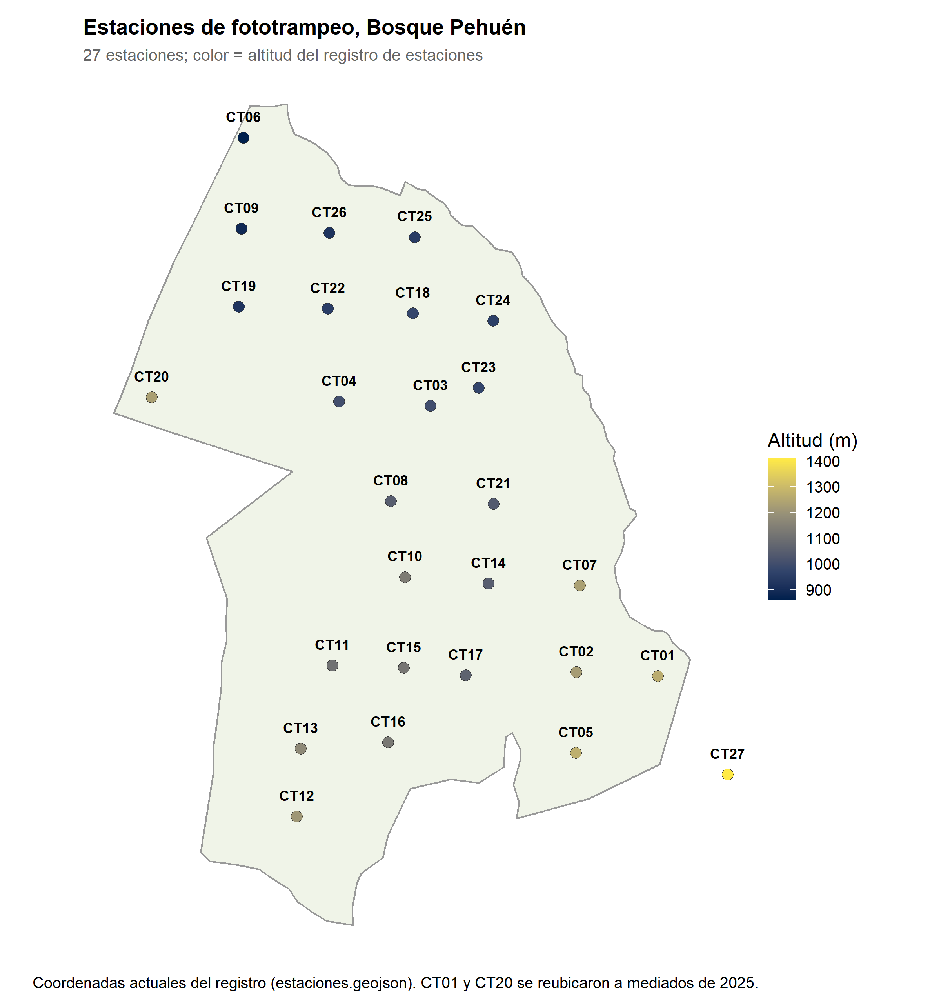
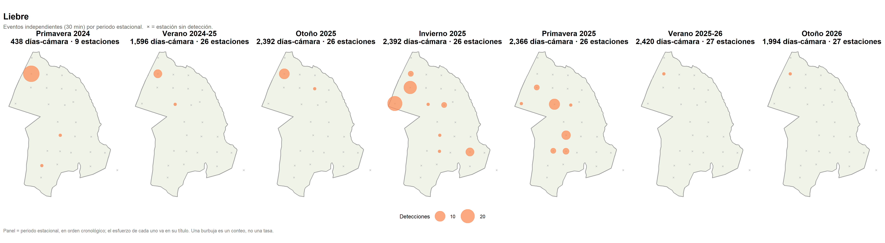
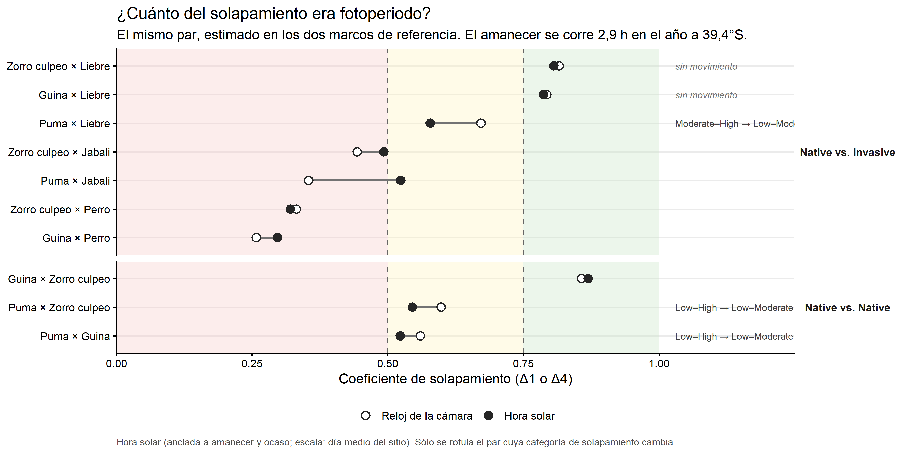

# Resumen

Llevamos 19 meses de registro continuo de 27 cámaras trampa. De ellos salen **415 eventos
independientes** de seis especies focales: tres carnívoros nativos (puma, güiña, zorro culpeo)
y tres invasoras (jabalí, liebre, perro).

Este documento ordena lo hecho según las preguntas que nos planteamos como equipo. Para cada
una dice qué métodos se usaron, qué muestran hasta ahora y qué métodos se podrían usar
después.

| Pregunta | Estado | Lo principal hasta ahora |
|---|---|---|
| (i) Tasas de detección | **Hecho** | La **liebre** cae fuertemente desde diciembre de 2025 en las estaciones con reloj válido, pero sigue presente en CT18, cuyo reloj falló (sección 2.2) |
| (ii) Patrones espaciales | **Parcial** | Descriptivo. Modelos de ocupación preliminares, todavía no citables (sección 3.2) |
| (iii) Patrones temporales | **Hecho** | **Los nativos coinciden poco en el horario con el perro**, en los dos marcos de tiempo (sección 4.3) |
| (iv) Espacio y tiempo juntos | **No iniciado** | Es el principal vacío del proyecto (sección 5) |

El resultado más sólido es temporal: el culpeo y la güiña son nocturnos y el perro es
estrictamente diurno. Todavía no sabemos si es evitación o solo el horario propio del perro.

El hallazgo que más pide explicación es la liebre. Era la segunda especie más registrada.
Desde diciembre de 2025 deja de aparecer en las cámaras con reloj válido, que siguen
funcionando y registrando otros animales: en esas estaciones quedan solo 2 eventos en el
otoño de 2026. **Pero no desaparece del arreglo.** CT18, cuyo reloj falló, registró entre 9 y
11 eventos de liebre en el mismo período. No sabemos sus fechas, pero sí sabemos que son
posteriores al 28 de noviembre de 2025 (sección 2.2). Parte de la comparación entre años está
afectada además por cambios en la instalación de las cámaras.

---

# 0. Objetivo y preguntas

**Objetivo.** i) Evaluar las tasas de detección, ii) patrones espaciales de actividad y
iii) patrones temporales de actividad de mamíferos nativos e invasores en las cámaras trampa
desplegadas en Bosque Pehuén.

Los resultados esperados agregan una cuarta pregunta, la relación entre el uso del espacio y
el horario. Este documento la trata como pregunta (iv):

| Pregunta | Qué se pregunta | Sección |
|---|---|---|
| (i) Tasas de detección | ¿Con qué frecuencia se registra cada especie, y cómo cambia entre temporadas? | 2 |
| (ii) Patrones espaciales | ¿Dónde están las especies y qué proporción de los sitios usan? | 3 |
| (iii) Patrones temporales | ¿A qué hora están activas, cómo cambia en el año y cuánto coinciden entre especies? | 4 |
| (iv) Espacio y tiempo juntos | ¿Una especie evita los lugares que otra acaba de usar? ¿El horario cambia según el sitio? | 5 |

**Dos precisiones de alcance.** Con cámaras fijas e individuos sin marcar **no se puede medir
movimiento** de animales. Y **"selección de hábitat"** (uso del hábitat en relación con lo
disponible) requiere describir el hábitat de cada cámara, cosa que todavía no se ha hecho. Por
eso la pregunta (ii) se trata hoy como **uso de sitios y distribución**, y la selección de
hábitat aparece entre los métodos posibles (sección 3.3).

Cada sección sigue el mismo orden: **qué se hizo** (con una breve descripción del método),
**qué muestra**, **qué se podría hacer** y **qué requiere**.

---

# 1. Los datos (base común a todas las preguntas)

## 1.1 El arreglo de cámaras

Hay **27 estaciones (CT01–CT27)** entre 861 y 1.408 m de altitud. Las estaciones de
menor altitud están en el norte de la reserva (CT06, CT09, CT19) y las más altas en el sureste
(CT01, CT05, CT27). CT27 se instaló en diciembre de 2025 y queda fuera del polígono de la
reserva. CT01 y CT20 se reubicaron a mediados de 2025. El mapa muestra su posición actual.

## 1.2 Período y esfuerzo de muestreo

El registro va del **9 de octubre de 2024 al 15 de mayo de 2026**. Las tarjetas se retiraron
en tres campañas de terreno (otoño 2025, primavera 2025, otoño 2026). Cada campaña cubre el
intervalo entre dos visitas y mezcla varias estaciones del año. Por eso todo el análisis se
ordena por **temporada**, calculada desde la fecha de cada foto, y no por campaña. Así quedan
siete temporadas, con dos otoños, dos primaveras y dos veranos. Eso permite preguntar si un
patrón se repite.

El arreglo creció con el tiempo. En primavera de 2024 había 9 cámaras; desde el verano
2025-26 hay 27. El esfuerzo total es de **13.598 días-cámara**. De esos, **11.823** son útiles
para calcular tasas, porque tienen fotos con un reloj confiable:

| Temporada | Días-cámara útiles | Estaciones muestreando |
|---|---:|---:|
| Primavera 2024 | 438 | 9 |
| Verano 2024-25 | 1.342 | 25 |
| Otoño 2025 | 1.656 | 25 |
| Invierno 2025 | 2.077 | 26 |
| Primavera 2025 | 2.099 | 26 |
| Verano 2025-26 | 2.292 | 27 |
| Otoño 2026 | 1.919 | 27 |

*Estas cifras cambiaron el 3 de noviembre de 2026: cuatro despliegues que se habían
descartado por "reloj dañado" resultaron tener el reloj recuperable (sección 1.4).*

La figura siguiente muestra cada despliegue (el período entre dos visitas) por estación.
Explica de una vez por qué el esfuerzo es desigual y de dónde vienen las fotos sin hora
utilizable (sección 1.4).

Hubo 79 despliegues. 74 produjeron fotos. 4 grabaron solo video (CT22, CT24, CT25 y CT26,
primer período), que hoy queda fuera del flujo de análisis, y 1 tarjeta falló (CT21).

## 1.3 Qué contienen las 35.807 imágenes

| Contenido | Imágenes | % |
|---|---:|---:|
| Vacías (disparos sin animal) | 31.090 | 86,8 |
| Personas | 1.424 | 4,0 |
| Vehículos | 250 | 0,7 |
| No identificables | 521 | 1,5 |
| **Animales** | **2.522** | **7,0** |

Todas las imágenes con animal fueron revisadas por una persona: 1.447 se confirmaron y 1.912
se corrigieron. El animal más fotografiado es el **vacuno** (579 imágenes), seguido de liebre
(389) y zorro culpeo (335). También aparecen especies que no son focales en este análisis pero
son relevantes: **ciervo rojo** (87, invasor), caballo (123), monito del monte (55) y pudú (31).

**Método: el evento independiente.** La unidad de análisis es el evento, no la foto. Una
cámara toma 2–3 fotos por disparo, y un animal que se queda frente a ella genera muchas. Por
eso se agrupan las fotos de una misma especie en una misma estación separadas por menos de 30
minutos, y cada grupo cuenta como un registro. Ejemplo: las 579 fotos de vacuno son solo 19
eventos.

| Especie | Eventos independientes |
|---|---:|
| Zorro culpeo | 185 |
| Liebre | 131 |
| Perro | 49 |
| Jabalí | 19 |
| Güiña | 16 |
| Puma | 15 |

**Los registros están concentrados.** CT03 y CT09 reúnen el 34 % de todos los eventos. 56 de
los 185 eventos del culpeo están en CT03. Tres estaciones (CT17, CT23 y CT27) nunca
registraron una especie focal con hora válida.

## 1.4 Imágenes con uso limitado: fotos sin hora

Hay que distinguir dos niveles. Las imágenes sin animal no sirven para este estudio. Pero
dentro de las imágenes con animal hay un segundo grupo: aquellas cuya **cámara tenía el reloj
dañado**. Esas fotos prueban que el animal estuvo en esa estación, pero no cuándo. **Sirven
para la pregunta (ii)** (mapas de presencia) y **no sirven para las preguntas (i), (iii) ni
(iv)**, ni para nada que use fecha u hora: actividad diaria, temporadas, tasas o solapamiento.

**Revisión del 3 de noviembre de 2026.** Cuatro despliegues que el procedimiento marcaba como
"reloj no reparable" tenían el reloj bien o recuperable. Al revisar las fotos, Felipe no vio
problemas en CT08. Eso llevó a revisar los 11 despliegues rechazados, uno por uno:

- **CT08, otoño 2025.** El reloj se configuró un mes atrás (septiembre en vez de octubre),
  como dice la planilla de terreno. Las fotos del equipo al instalar y al retirar dan la misma
  diferencia, exactamente 30 días, y la hora del día nunca estuvo mal.
- **CT10, otoño 2025.** El reloj estaba bien. La planilla tenía mal la fecha de la visita de
  retiro (28 de mayo); las fotos muestran al equipo el 3 y el 5 de junio.
- **CT13, otoño 2025.** El reloj retrocedió exactamente una hora el 28 de febrero de 2025, a
  mitad de un disparo de tres fotos (02280048, 02280049, 02280050). Antes de ese punto todo
  queda bien. Después se recupera la fecha, pero no la hora, y solo afecta fotos vacías.
- **CT08, primavera 2025.** Un falso positivo del procedimiento: 2 fotos de 2.434 se nombraron
  con el día siguiente 3 minutos antes de medianoche. La regla que decide esto se cambió.

Los otros siete rechazos son fallas reales: reinicios de fábrica repetidos (CT15, CT16, CT19,
CT17, CT18 otoño 2026) o un registro del reloj internamente contradictorio. CT18 en primavera
2025 queda pendiente de revisión: el nombre de sus archivos va 30 días adelantado respecto de
la fecha de la foto, de forma constante.

Después de esa revisión, de las 2.522 imágenes con animal, **249 (10 %)** no tienen una hora
confiable. Entre las seis especies focales son **160 de 1.112 (14 %)**, pero la pérdida es
desigual:

| Especie | Imágenes con solo lugar | Total imágenes | % |
|---|---:|---:|---:|
| Jabalí | 34 | 149 | 23 |
| Liebre | 86 | 389 | 22 |
| Puma | 8 | 46 | 17 |
| Güiña | 3 | 29 | 10 |
| Zorro culpeo | 22 | 335 | 7 |
| Perro | 7 | 164 | 4 |

**De dónde vienen las imágenes de puma y jabalí sin hora.** De **dos despliegues**. En los
dos, la cámara funcionó todo el período pero su reloj no se pudo reconstruir:

| Despliegue | Puma | Jabalí | Problema del reloj |
|---|---:|---:|---|
| CT15, ene – jun 2025 | 6 | 1 | Reloj coherente pero sin punto de referencia |
| CT18, nov 2025 – may 2026 | 2 | 33 | Jabalí: registro del reloj corrupto. Puma: sin punto de referencia |

Los dos problemas son distintos:

- **Reloj coherente sin punto de referencia** (CT15 y los 2 pumas de CT18). El reloj
  avanzó de forma pareja, pero en algún momento se desconfiguró (por ejemplo, al cambiar
  baterías) y quedó con una fecha equivocada. Para corregirlo se necesita al menos un
  **testigo**: una foto cuya hora real se conozca, como la de una persona del equipo en una
  visita registrada. Sin testigo dentro de ese tramo no se puede saber cuánto corregir.
  **Es recuperable** si aparece evidencia de terreno.
- **Registro del reloj corrupto** (los 33 jabalíes de CT18). La fecha que la cámara escribe en
  el nombre de cada archivo no coincide con la fecha guardada dentro de la imagen. El reloj no
  estaba solo desplazado; su registro es internamente contradictorio. **No es recuperable**:
  no hay una única corrección que lo arregle.

**Qué significa para el análisis.** CT18 está entre los cuatro sitios con más fotos de
jabalí. Por eso la curva de actividad del jabalí y sus solapamientos se calculan sin uno de
sus sitios principales: de CT18 quedan solo 2 fotos con hora.

El puma figura en 8 estaciones en el mapa de presencia y en 7 en los análisis con hora; se
pierde CT18. En CT15 se pierden 6 fotos de enero a junio de 2025. Esto importa para la
pregunta (i): **esas 6 fotos sin fecha podrían ser de otoño de 2025**, la temporada en la que
el puma aparece sin registros.

Para la liebre hay un caso más difícil: **65 fotos en CT19 entre febrero y junio de 2025**.
El reloj de CT19 se reinició de fábrica una y otra vez. El despliegue quedó partido en **68
tramos de reloj**, y 8 de ellos tienen el registro contradictorio. Un testigo corrige solo
el tramo en que cae. Por eso esas fotos **se recuperan solo en parte**: haría falta un testigo
por tramo, y los tramos contradictorios no se recuperan.

**Cuántos eventos se pierden.** Aunque no se conozca la fecha, en muchos casos sí se puede
contar los eventos. Cuando el reloj es coherente pero sin punto de referencia, la distancia
entre dos fotos sigue siendo real, y la regla de 30 minutos se aplica igual dentro de cada
tramo del reloj. Ese conteo es exacto. Cuando el registro del reloj es contradictorio no hay
distancias confiables, y solo se puede dar un rango: entre 1 evento y uno por foto.

Todas las campañas, todas las estaciones donde la especie aparece, con o sin reloj válido:

| Especie | Estaciones | Con reloj dañado (fotos) | Eventos utilizables | Eventos perdidos | % perdido |
|---|---:|---|---:|---:|---:|
| Puma | 8 | CT15 (6), CT18 (2) | 15 | 3 | 17 |
| Jabalí | 9 | CT15 (1), CT18 (33) | 19 | 2–34 | 10–64 |
| Liebre | 11 | CT18 (21), CT19 (65) | 131 | 11–85 | 8–39 |
| Zorro culpeo | 19 | CT15 (6), CT18 (16) | 185 | 13–21 | 7–10 |
| Güiña | 10 | CT16 (3) | 16 | 2–3 | 11–16 |
| Perro | 13 | CT15 (1), CT18 (4), CT19 (2) | 49 | 5–7 | 9–12 |

Los rangos amplios vienen de dos casos con el registro del reloj contradictorio: el jabalí de
CT18 (33 fotos, entre 1 y 33 eventos) y la liebre de CT19 (65 fotos repartidas en tramos
coherentes y contradictorios). La liebre de CT18 incluye
además 9 fotos de primavera 2025, el despliegue que queda pendiente de revisión. Solo para la última
campaña (otoño 2026), la pérdida se concentra en CT18, la única estación con reloj dañado:

| Especie | Estaciones con la especie | Eventos utilizables | Eventos perdidos (CT18) | % perdido |
|---|---|---:|---:|---:|
| Liebre | CT09, CT18 | 2 | 9–11 | 82–85 |
| Jabalí | CT06, CT15, CT18 | 3 | 1–33 | 25–92 |
| Puma | CT10, CT15, CT16, CT18 | 3 | 1 | 25 |
| Zorro culpeo | 15 estaciones | 52 | 8–16 | 13–24 |
| Perro | 8 estaciones | 14 | 2 | 12 |
| Güiña | CT06, CT10, CT16, CT22 | 7 | 0 | 0 |

**El orden de las fotos se conoce aunque la fecha no.** El contador del nombre de archivo de
CT18 permite ordenar sus fotos. Su último tramo con hora real termina el **28 de noviembre de
2025**; todas sus fotos de liebre y de puma de esa campaña vienen después. Esto importa para
la sección 2.2.

---

# 2. Pregunta (i): tasas de detección

**Estado: hecho.** Tasas por especie, estación y temporada.

## 2.1 Qué se hizo

**Método: tasa de detección.** Es el número de eventos independientes por cada 100
días-cámara. Dividir por el esfuerzo permite comparar temporadas en que funcionaron distintas
cantidades de cámaras (de 438 a 2.292 días-cámara útiles por temporada, sección 1.2). La tasa mide cuántas veces
se fotografía una especie, no cuántos animales hay: depende también de cuánto se mueven, de
dónde está la cámara y de su altura.

Lo que muestra por especie:

**Zorro culpeo** es el fondo estable del registro. Su tasa está entre 1 y 3 eventos por 100
días-cámara en todas las temporadas.

**Perro** alcanza su máximo en el verano 2025-26: 0,61 eventos por 100 días-cámara, en 5
estaciones. Sus registros se concentran en CT09 (14 eventos) y CT03 (9).

**Puma** no tiene eventos con fecha en ninguna temporada de otoño o invierno. Con 15 eventos
en total esto es una descripción, no un resultado. Además, 6 fotos de puma sin fecha (CT15)
podrían caer en el otoño de 2025, y el evento de puma de CT18, posterior al 28 de noviembre
de 2025, podría caer en el otoño de 2026 (sección 1.4).

**Güiña y jabalí** tienen 16 y 19 eventos. Al jabalí le falta uno de sus sitios principales
(CT18) en todo lo que usa la hora (sección 1.4).

## 2.2 Hallazgo destacado: la liebre cae en casi todo el arreglo desde diciembre de 2025

> **Este resultado pide una explicación biológica.** Los datos se revisaron dos veces y los
> conteos se sostienen. Una parte de la comparación entre años está afectada por cambios en
> la instalación de las cámaras, y eso se detalla abajo. Pero la caída simultánea en las
> estaciones donde la liebre estaba no se explica por esos cambios. **La liebre no
> desaparece del arreglo**: sigue presente en CT18, una estación cuyo reloj falló y que por
> eso no entra en las tasas.

**Lo que muestran los datos.** Eventos de liebre por temporada, en las estaciones donde
aparece:

| Estación | Prim 2024 | Ver 24-25 | Oto 2025 | Inv 2025 | Prim 2025 | Ver 25-26 | Oto 2026 |
|---|---:|---:|---:|---:|---:|---:|---:|
| CT09 | 29 | 6 | 10 | 2 | 0 | 1 | 1 |
| CT20 | — | 0 | 0 | 23 | 1 | 0 | 0 |
| CT19 | — | *s/h* | *s/h* | 17 | 2 | 0 | 0 |
| CT04 | 0 | 1 | 0 | 1 | 11 | 0 | 0 |
| CT10 | 1 | 0 | 0 | 1 | 7 | 0 | 0 |
| CT02, CT03, CT11, CT13, CT15, CT18 | 1 | 0 | 1 | 9 | 6 | 0 | 0 |
| **Total** | **31** | **7** | **11** | **53** | **27** | **1** | **1** |
| **Por 100 días-cámara** | 7,08 | 0,52 | 0,66 | 2,55 | 1,29 | **0,04** | **0,05** |

*s/h: la cámara funcionaba pero sin reloj utilizable. —: la estación aún no estaba instalada.*

Entre los dos otoños la tasa cae de 0,66 a 0,05, unas 13 veces. Los tres eventos de
noviembre de 2025 son los últimos en esas estaciones, salvo dos en CT09 (enero y abril
de 2026).

**La excepción: CT18.** La tabla y la tasa usan solo estaciones con reloj válido. CT18 tuvo
el reloj dañado durante todo el despliegue de noviembre 2025 a mayo 2026, así que queda fuera
tanto del numerador como del denominador. Pero sus fotos muestran **12 fotos de liebre, entre
9 y 11 eventos**, todas posteriores al 28 de noviembre de 2025 (sección 1.4). Es decir, en el
período en que las demás estaciones quedan en silencio, CT18 registra más eventos de liebre
que todo el resto del arreglo junto. Las tasas de 0,04 y 0,05 son correctas para las
estaciones con reloj válido, pero no describen el arreglo completo.

**Lo que se verificó y descartó como artefacto:**

- **Las cámaras funcionaban.** CT09, CT19 y CT20 operaron con reloj válido durante todo el
  verano 2025-26 y el otoño 2026 (figura de la sección 1.2). Siguieron registrando otros
  animales: CT19 registró caballo (39 fotos) y aves que caminan por el suelo, como chucao y
  hued-hued; CT20 registró ciervo rojo y CT09 perros. Una cámara que registra un chucao
  puede registrar una liebre.
- **No está oculta entre las fotos sin identificar.** Las 398 imágenes no identificables del
  otoño 2026 se concentran en CT08 (167) y CT22 (118). En ninguna de las dos estaciones se ha
  registrado nunca una liebre.
- **Sí hay liebres ocultas por un reloj dañado, en CT18.** Una versión anterior de este
  documento decía que esas 12 fotos sin fecha equivalían a "unos pocos eventos". Contadas con
  el reloj de la propia cámara son entre 9 y 11 eventos, cuatro a cinco veces los 2 eventos
  con fecha del resto del arreglo.
- **No es un error de identificación.** Todas las fotos de animales fueron revisadas por una
  persona, y solo hay un registro de conejo en todo el período (CT04, enero de 2025).

**Lo que sí afecta la comparación entre años.** Las notas de terreno registran tres cambios
de instalación, justo en las estaciones donde estaba la liebre:

- **CT09**: cámara elevada a unos 2 m el 14 de mayo de 2025.
- **CT19**: cámara elevada a unos 2 m el 5 de junio de 2025.
- **CT20**: reubicada a un punto abierto junto al sendero el 9 de junio de 2025.

CT09 llevaba casi toda la liebre del verano y el otoño de 2025 (45 de sus 49 eventos fueron
antes de elevarla). Después de elevarla, sus fotos de animales cayeron de 183 a 9 y 8 por
campaña. Por eso **la comparación verano con verano y otoño con otoño compara en gran parte a
CT09 a ras de suelo con CT09 a 2 m**. Esa caída de 13 veces no puede atribuirse por completo
a la liebre.

**Lo que se sostiene a pesar de eso.** CT19 y CT20 ya estaban en su nueva configuración cuando
registraron 43 eventos de liebre entre junio y octubre de 2025. En la primavera de 2025 la
liebre además se extendió a CT02, CT04, CT10, CT11 y CT15. Desde diciembre de 2025 **todas esas
estaciones quedan en silencio al mismo tiempo**, con la misma instalación (hasta donde se
registró) y registrando otras especies. CT18 no está en esa lista: ahí la liebre sigue.

**Tres explicaciones posibles**, que hoy no se pueden distinguir:

1. **Patrón estacional.** La liebre usa estos sitios de bosque y borde en invierno y primavera
   y se desplaza en verano y otoño, por ejemplo hacia praderas abiertas fuera del arreglo. El
   cambio de altura de CT09 impide comparar con el verano anterior.
2. **Disminución real de la población** por enfermedad, depredación, control o caza, u otra
   causa. Vale la pena preguntar a los guardaparques si hubo controles o hallazgos de
   animales muertos. Que CT18 siga registrando liebres le resta peso a esta explicación.
3. **Cambio de los sitios que usa.** La liebre deja las estaciones del norte (CT09, CT19,
   CT20) y del interior y se concentra en otros puntos, CT18 entre ellos.

**Cómo distinguirlas.** Hay tres pasos concretos (sección 7):

- **Fechar las fotos de CT18.** Con un testigo de terreno para los tramos sin punto de
  referencia se recuperan las fechas de 9 de las 12 fotos. Diría si la liebre de CT18 está
  en el verano, en el otoño o en ambos.

- **Confirmar con el equipo de terreno que en la visita de noviembre–diciembre de 2025 no se
  movió ni se reorientó ninguna cámara.** Esa visita no tiene notas en el registro de terreno.
- **Esperar el invierno y la primavera de 2026.** Si la liebre vuelve a CT19, CT20, CT04 y
  CT10 entre junio y octubre de 2026, el patrón es estacional. Si no vuelve, es una
  disminución.

Hay que tener en cuenta que en la visita de mayo de 2026 **todas las cámaras se elevaron a
1,5–2 m**. Esa comparación tendrá entonces la misma limitación que CT09, ahora en todo el
arreglo.

## 2.3 Qué se podría hacer

- **Altura de cámara como variable.** Hubo cambios de altura en 2025 y una elevación general
  en mayo de 2026. Si se registra la altura exacta por estación en cada visita (sección 7),
  puede entrar como covariable de la tasa y de la detección (p) en los modelos de ocupación.
  Cambia qué animales pequeños se detectan.
- **Sensibilidad al umbral de independencia.** Repetir las tasas con umbrales de 15, 30 y 60
  minutos para mostrar que el resultado no depende de esa elección. Lo pedirá un revisor.
- **Recuperar fotos sin hora** (sección 1.4). CT08, CT10 y CT13 ya se recuperaron el 3 de
  noviembre de 2026. Con testigos de terreno para CT15 (enero–junio 2025) se recuperan 6
  fotos de puma y 1 de jabalí. Con testigos para CT18 (noviembre 2025 – mayo 2026) se
  recuperan las fechas de 9 fotos de liebre, 2 de puma y 7 de culpeo. Las 65 fotos de
  liebre de CT19 (febrero–junio 2025) se recuperan solo en parte: el reloj quedó en 68
  tramos, y cada uno necesitaría su propio testigo.
- **Simulación de poder estadístico.** Estimar cuántas campañas o estaciones más se necesitan
  para que puma, güiña y jabalí entren en los análisis de ocupación y solapamiento. Convierte
  el problema de muestra en una recomendación de diseño de muestreo.

---

# 3. Pregunta (ii): patrones espaciales (uso de sitios y distribución)

**Estado: parcial.** Lo descriptivo está hecho. Los modelos de ocupación son preliminares.

## 3.1 Qué se hizo: descripción

**Métodos.**

- **Mapas de presencia y ausencia** por especie, y **mapas de riqueza** (número de especies
  focales por estación). Usan también las fotos sin hora (sección 1.4).
- **Mapas de burbujas**: cada estación se dibuja con un círculo proporcional a su número de
  eventos.
- **Ocupación ingenua**: proporción de estaciones donde la especie se vio al menos una vez en
  la temporada. Es "ingenua" porque trata cada estación sin registro como si la especie no
  estuviera.

**Qué muestra.**

- **Zorro culpeo** aparece en el 16–44 % de las estaciones cada temporada.
- **Perro**: hasta 5 estaciones en el verano 2025-26, con los registros concentrados en CT09
  y CT03.
- **Puma** figura en 8 estaciones en el mapa de presencia.
- Los registros en general están **concentrados**: CT03 y CT09 reúnen el 34 % de los eventos
  (sección 1.3).

## 3.2 Qué se hizo: ocupación (preliminar)

Que una especie no aparezca en una cámara no prueba que no use ese lugar. Puede haber pasado
sin ser fotografiada.

**Método: modelo de ocupación de una temporada** (MacKenzie et al. 2002). Separa dos cosas:
la proporción de sitios que la especie realmente usa (**ψ**) y la probabilidad de detectarla
en un período cuando está (**p**). La idea es simple: si en las estaciones donde la especie
sí aparece se la detecta solo en algunos períodos, entonces algunas estaciones "vacías"
probablemente también la tienen y no la fotografiaron. El modelo usa esa repetición para
estimar cuántas.

Para eso se construyó, para cada especie y temporada, una tabla de estaciones por períodos de
14 días (**ocasiones**). Cada casilla vale 1 si la especie se detectó, 0 si la cámara funcionó
y no la detectó, o "sin dato" si la cámara no estaba operando.

El largo de 14 días **se midió antes de elegirlo**. Se probaron largos de 1 a 14 días. Con 1 día
el modelo queda en el borde (ψ = 1, sin información útil); de 3 a 14 días ψ apenas cambia:
para el culpeo en invierno 2025 va de 0,50 a 0,54. La probabilidad de detectar la especie al
menos una vez en la temporada se mantiene en 77–84 %. Es decir, el largo de la
ocasión solo reparte la misma información de otra manera.

**Qué muestran los primeros modelos:**

- **Zorro culpeo**, invierno 2025: usa cerca del **54 %** de las estaciones. Donde está, cada
  ocasión de 14 días tiene una probabilidad de 0,20 de fotografiarlo. Se vio en el 40 % de las
  estaciones (10 de 25); el resto de la diferencia son estaciones usadas donde no se
  fotografió. Son 25 y no las 26 de la sección 1.2 porque CT16 estuvo operando ese invierno,
  pero con el reloj dañado en sus dos despliegues: cuenta como estación muestreando, pero no
  aporta ocasiones con fecha al modelo.
- **Perro**, invierno 2025: ψ ≈ 0,41–0,45 con ocasiones de 7 a 14 días, pero con p de
  0,03–0,08. Según el modelo, la mayoría de las estaciones
  que usa nunca lo registran. La conclusión depende más del modelo que de los datos.
- **Liebre**: es el caso de detección desigual. La liebre se registraba casi continuamente en
  CT09 y casi nunca en el resto. Un modelo con una sola p para todas las estaciones tiende a
  subestimar ψ.
- **Puma, güiña y jabalí no se pueden modelar así.** Se detectan en 0 a 4 estaciones por
  temporada.

> **Estos valores todavía no se pueden citar.** Se ajustaron con un cálculo propio, sin
> errores estándar. Falta ajustarlos con el paquete estándar (`unmarked`), con altitud como
> covariable.

## 3.3 Qué se podría hacer

- **Ocupación con covariables, bien ajustada.** Ajustar culpeo y liebre con `unmarked`, con
  altitud y descriptores de hábitat por cámara en ψ, y el esfuerzo en p. Con descriptores de
  hábitat, esto es lo que permite hablar de **selección de hábitat**: si ψ sube o baja con
  la cobertura, el tipo de bosque o la distancia a senderos. Requiere levantar los
  descriptores de hábitat de cada estación.
- **Modelo de Royle–Nichols para la liebre** (Royle y Nichols 2003). Permite que la detección
  sea distinta según la abundancia local: una estación con muchas liebres las detecta más
  seguido. Se ajusta al caso de CT09.
- **Actividad humana como covariable.** Las 1.674 imágenes de personas y vehículos dan una
  medida de uso humano por estación. Puede explicar la presencia del perro y, en la pregunta
  (iv), la nocturnidad de los nativos. Conecta además con CT19, cerca de las casas de los
  guardaparques.
- **Ganado y ciervo rojo.** El vacuno es el animal más fotografiado y el ciervo rojo es un
  invasor que hoy no se analiza. Pueden entrar como factores de perturbación o como especies
  focales; esto último cambiaría el alcance del estudio.

**Métodos que conviene excluir explícitamente, citando por qué:**

- Ocupación conjunta de varias especies: pide cientos de sitios.
- Densidad sin individuos identificados (REM, REST): el protocolo no mide distancias.
- Captura–recaptura espacial para güiña: requiere cámaras cenitales.

---

# 4. Pregunta (iii): patrones temporales

**Estado: hecho** para la actividad diaria y el solapamiento. **Pendiente** la variación
entre temporadas.

## 4.1 Curvas de actividad

**Método: densidad de kernel circular.** Cada evento se ubica en un reloj de 24 horas, y se
estima una curva suave de cómo se reparten los eventos en el día (densidad de kernel de von
Mises, paquete `overlap` de R). Es como un histograma por hora, pero sin depender de dónde se
cortan las barras, y entendiendo que las 23:59 y las 00:00 son vecinas. Se exige un mínimo de
30 eventos por especie para estimar una curva.

**Qué muestra:**

- **Zorro culpeo**: nocturno, con un repunte al amanecer y un máximo cerca de las 22:00.
- **Liebre**: crepuscular y nocturna, con un pico marcado justo después de la puesta de sol.
- **Perro**: estrictamente diurno.

Güiña (16), jabalí (19) y puma (15) no tienen curva propia porque están bajo el umbral de 30
eventos.

## 4.2 Hora del reloj y hora solar

**El problema.** Un animal no se rige por el reloj sino por la luz. A 39,4°S la hora del
amanecer y la puesta cambia mucho en el año:

| Fecha | Amanecer | Puesta | Horas de luz |
|---|---|---|---|
| 20 de junio de 2025 | 08:07 | 17:30 | 9,4 h |
| 20 de diciembre de 2025 | 05:17 | 20:14 | 15,0 h |
| **Diferencia** | **2,9 h** | **2,8 h** | **5,6 h** |

Un ejemplo concreto: un culpeo fotografiado a las **20:00 en junio** está activo dos horas y
media después de oscurecer. Uno fotografiado a las **20:00 en diciembre** está activo antes de
la puesta, con luz. Es la misma hora del reloj en situaciones opuestas. Al juntar 19 meses de
registro en una sola curva por hora del reloj, una especie que siempre sale "una hora después
de la puesta" aparece repartida en casi tres horas. Los picos se aplanan y el nivel de
actividad se sobreestima. Rowcliffe et al. (2014) describen este efecto y solo eximen a los
estudios tropicales o muy cortos. El nuestro no es ninguna de las dos cosas.

**Método: hora solar de doble anclaje** (Nouvellet et al. 2012; Vazquez et al. 2019), con la
función `transtime()` del paquete `activity` de R. En una frase: cada detección se mide
respecto del amanecer y la puesta de *ese* día, en vez de respecto del reloj. Para cada
detección:

1. Se calcula la hora del amanecer y de la puesta **ese día** en el sitio.
2. Si la detección ocurrió de día, se mide qué fracción del período de luz de ese día había
   pasado. Si ocurrió de noche, qué fracción de la noche.
3. Esa fracción se traslada a un **día de referencia**: el día promedio del sitio en el año,
   con amanecer a las **06:42** y puesta a las **18:52**.

Por ejemplo, una detección a mitad de la noche de junio y otra a mitad de la noche de
diciembre quedan en la misma posición, aunque sus horas de reloj difieran. En este marco el
amanecer y la puesta caen siempre en el mismo punto. Por eso en la figura son líneas exactas
y no bandas aproximadas.

**Un detalle técnico que importa.** Por defecto, `transtime()` calcula el día de referencia
como el promedio de las fechas que se le entregan. Eso hace que una misma detección cambie
de posición según qué otras detecciones se procesen junto con ella. Se midió: la misma
detección se movía **42 minutos** entre procesar la tabla completa y procesar 50 filas. Como
el solapamiento se calcula especie por especie, cada par habría quedado en un reloj
ligeramente distinto. Por eso **el día de referencia se fijó al ciclo anual completo del
sitio**, y un test automático lo verifica.

**Qué cambió al aplicarlo.**

- Las curvas se afinan donde se esperaba: el pico vespertino de la liebre se angosta y la
  subida del culpeo después de la puesta se hace más pronunciada.
- En el solapamiento, la diferencia promedio entre los dos marcos es 0,048 y la máxima 0,170
  (puma × jabalí). Tres de diez pares cambian de categoría, los tres con puma (15 eventos):
  en hora solar puma × güiña y puma × culpeo pasan de Bajo–Alto a Bajo–Moderado, y puma ×
  liebre de Moderado–Alto a Bajo–Moderado. Ninguno pasa a una conclusión opuesta.
- El resultado principal se mantiene: el solapamiento de los nativos con el perro es bajo en
  ambos marcos.

**Lo que este método no corrige** (debe ir en Métodos):

- **El horario de la cámara.** Se asume que todas las cámaras están en UTC−4 (horario de
  invierno, sin cambio de verano). Si alguna estuviera en UTC−3, el error máximo sería de 11,4
  minutos. Está acotado y verificado.
- **El horizonte.** El cálculo del amanecer supone un horizonte plano a nivel del mar. Donde
  hay un cerro al este, la primera luz real llega más tarde. Se podría verificar con la
  radiación solar medida por nuestra estación meteorológica.
- **Una coordenada para todo el sitio.** Entre las dos estaciones más alejadas el amanecer
  difiere en 16 segundos, frente a las 2,9 horas de variación anual. Usar una coordenada por
  estación sería precisión falsa.

## 4.3 Solapamiento temporal entre pares de especies

**Método: coeficiente de solapamiento** (Ridout y Linkie 2009). Se superponen las curvas de
actividad de dos especies y se mide el área que comparten. Va de 0 (nunca activos a la misma
hora) a 1 (curvas idénticas). Se usa el estimador Δ4 cuando la especie con menos datos tiene
al menos 50 eventos, y Δ1 por debajo de eso, que se comporta mejor con muestras chicas. El
intervalo de confianza del 95 % se obtiene **remuestreando** los eventos 1.000 veces
(bootstrap): se recalcula el solapamiento con muestras al azar y se ve cuánto varía. Cada par
se clasifica como Bajo (< 0,50), Moderado (0,50–0,75) o Alto (≥ 0,75) (Monterroso et al.
2014) **solo si todo el intervalo cae en una categoría**. Si el intervalo cruza un límite, el
par recibe una categoría compuesta.

Se calculó para los diez pares nativo–nativo y nativo–invasor. Hora del reloj:

| Par | n | Solapamiento [IC 95 %] | Categoría |
|---|---|---|---|
| Güiña × perro | 16 / 49 | 0,26 [0,09–0,43] | **Bajo** |
| Zorro culpeo × perro | 185 / 49 | 0,33 [0,24–0,43] | **Bajo** |
| Puma × jabalí | 15 / 19 | 0,35 [0,15–0,57] | Bajo–Moderado |
| Zorro culpeo × jabalí | 185 / 19 | 0,44 [0,26–0,63] | Bajo–Moderado |
| Puma × güiña | 15 / 16 | 0,56 [0,36–0,77] | Bajo–Alto |
| Puma × zorro culpeo | 15 / 185 | 0,60 [0,41–0,76] | Bajo–Alto |
| Puma × liebre | 15 / 131 | 0,67 [0,51–0,83] | Moderado–Alto |
| Güiña × liebre | 16 / 131 | 0,79 [0,62–0,91] | Moderado–Alto |
| Zorro culpeo × liebre | 185 / 131 | 0,82 [0,73–0,89] | Moderado–Alto |
| Güiña × zorro culpeo | 16 / 185 | 0,86 [0,69–0,99] | Moderado–Alto |

**Cómo leerlo.**

- **Nativos y perro: Bajo, en ambos marcos.** Es el resultado más sólido del proyecto.
- **Nativos y jabalí: Bajo a Moderado.** Con 19 eventos de jabalí, y sin uno de sus sitios
  principales (sección 1.4).
- **Nativos y liebre: alto.** Coinciden en el horario nocturno y crepuscular. La excepción es
  puma × liebre en hora solar, que baja a Bajo–Moderado.
- **Pares con puma: sin conclusión.** Los intervalos van de Bajo a Alto. Con 15 eventos no se
  puede afirmar nada.

## 4.4 Qué se podría hacer: variación entre temporadas y ambiente

- **Cambios de actividad entre temporadas.** Comparar el horario y el nivel de actividad del
  culpeo entre invierno y verano. Responde si los nativos ajustan su horario a lo largo del
  año. Es barato: los módulos necesarios ya existen.
- **Luna y clima sobre la actividad del culpeo.** La fase lunar es una prueba clásica para
  carnívoros nocturnos, y 185 eventos alcanzan. La estación meteorológica aporta temperatura
  y lluvia de cada noche.
- **Análisis de sensibilidad que pedirá un revisor.**
  - Límites de temporada por solsticios y equinoccios.
  - Amanecer calculado contra el amanecer medido por la estación meteorológica.

**Método que conviene excluir:** las razones de evitación–atracción, porque el método fue
refutado.

---

# 5. Pregunta (iv): espacio y tiempo juntos

**Estado: no iniciado.** Es el principal vacío del proyecto.

Todo lo anterior mira **dónde** o **cuándo** por separado. La pregunta central de un estudio
de interacciones combina ambas. Por ejemplo: después de que un perro pasa por una estación,
¿el culpeo tarda más en volver a esa estación que lo esperable por azar?

**Lo que lo limita es el tamaño de muestra.** Ningún par de especies comparte más de 10
estaciones. Solo tres pares tienen más de 40 eventos de cada especie en las estaciones que
comparten: culpeo × liebre (138 y 112), culpeo × perro (140 y 46) y liebre × perro (124 y
46). Falta fijar, con la literatura, el mínimo que pide esta clase de prueba.

**Qué se podría hacer** (prueba de si el perro desplaza a los nativos):

- **Actividad según el sitio.** Comparar la curva de actividad del culpeo en estaciones con y
  sin perro, con el mismo método de la sección 4.1. Si el culpeo es más nocturno donde hay
  perros, hay indicio de desplazamiento. La actividad humana por estación (sección 3.3) puede
  entrar del mismo modo.
- **Tiempo entre encuentros.** En las estaciones que comparten ambas especies, medir cuánto
  tarda el culpeo en aparecer después de un perro, y compararlo con lo que pasaría si los
  tiempos fueran al azar. El "azar" se construye **permutando** los registros: se reordenan
  muchas veces y se ve qué tan extremo es el valor real (Niedballa et al. 2019).
- **Sensibilidad.** Repetir el solapamiento sin CT03 y CT09, para ver si dos estaciones
  sostienen el resultado.
- El poder estadístico es bajo y hay que decirlo.

---

# 6. Lo que todavía no podemos afirmar

- **Que los nativos evitan al perro.** Un solapamiento bajo entre un zorro nocturno y un
  perro diurno ligado a personas es lo esperable aunque ninguno reaccione al otro. Hoy el
  resultado describe una **separación de horarios**, no una **evitación**. Responderlo es la
  pregunta (iv).
- **Que la liebre ocupa menos territorio que el culpeo.** Se detecta en menos estaciones,
  pero eso puede deberse a una detección desigual entre estaciones. Además faltan
  descriptores del hábitat de cada cámara.
- **Ningún valor de ocupación (ψ)** hasta reajustarlo con errores estándar.
- **Nada sobre puma, güiña ni jabalí más allá de su presencia.** Están bajo cualquier
  umbral de muestra razonable para modelos.
- **Que la caída de la liebre es una disminución.** Ver sección 2.2. Tampoco que la liebre
  desaparece del arreglo: CT18 la sigue registrando después de noviembre de 2025.

**Decisiones pendientes del equipo.** Si el marco solar será el principal o el análisis de
sensibilidad, y si el día de referencia será el promedio del sitio o el "equinoccial"
(amanecer a las 06:00 y puesta a las 18:00). Conviene decidirlo según qué usan los estudios
comparables de la región.

---

# 7. Tareas de terreno

No son análisis, pero varios análisis dependen de ellas:

- **Visita de noviembre–diciembre de 2025.** Confirmar que no se movió ni se reorientó
  ninguna cámara (sección 2.2).
- **Guardaparques.** Preguntar por controles de liebre o hallazgos de animales muertos
  (sección 2.2).
- **Invierno 2026.** Revisar la liebre en cuanto llegue la próxima campaña (sección 2.2).
- **Testigos para relojes.** Buscar fotos con hora real conocida para CT15 (otoño 2025), para
  CT19 (febrero–junio 2025; un testigo por tramo, recuperación solo parcial) y para CT18
  (noviembre 2025 – mayo 2026), esta última la más urgente por la liebre (secciones 1.4
  y 2.2).
- **Altura de cámara.** Registrar la altura exacta por estación en cada visita (sección 2.3).
- **Descriptores de hábitat por cámara.** Necesarios para la ocupación con covariables y la
  selección de hábitat (sección 3.3).

---

# 8. Prioridades

En orden de valor frente a lo que los datos permiten:

| # | Qué | Pregunta | Sección |
|---:|---|---|---|
| 1 | Ocupación con covariables, bien ajustada (`unmarked`, Royle–Nichols) | (ii) | 3.3 |
| 2 | Prueba de si el perro desplaza a los nativos | (iv) | 5 |
| 3 | Seguimiento de la liebre | (i) | 2.2, 7 |
| 4 | Recuperar fotos sin hora | (i), (iii) | 1.4, 2.3 |
| 5 | Cambios de actividad entre temporadas | (iii) | 4.4 |
| 6 | Usar las imágenes de personas y vehículos | (ii), (iv) | 3.3 |
| 7 | Ganado y ciervo rojo | (ii) | 3.3 |
| 8 | Luna y clima sobre la actividad del culpeo | (iii) | 4.4 |
| 9 | Altura de cámara como variable | (i) | 2.3 |
| 10 | Análisis de sensibilidad que pedirá un revisor | todas | 2.3, 4.4, 5 |
| 11 | Simulación de poder estadístico | todas | 2.3 |

---

# Glosario

**Evento independiente (episodio).** Conjunto de fotos de una misma especie en una misma
estación separadas por menos de 30 minutos. Cuenta como un registro.

**Día-cámara.** Un día con una cámara operando. Es el denominador del esfuerzo de muestreo.

**Tasa de detección.** Eventos por cada 100 días-cámara. Permite comparar temporadas con
distinto esfuerzo.

**Ocupación ingenua.** Proporción de estaciones donde la especie se vio al menos una vez. No
corrige por las veces que estuvo y no se detectó.

**ψ (psi).** Proporción de sitios que la especie realmente usa en una temporada, estimada por
un modelo de ocupación.

**p.** Probabilidad de detectar a la especie en una ocasión, dado que usa el sitio.

**Ocasión.** Bloque de días (aquí 14) en que se divide una temporada para el modelo de
ocupación.

**Densidad de kernel.** Curva suave que estima cómo se reparten los eventos en las 24 horas.
Una versión continua del histograma.

**Coeficiente de solapamiento.** Cuánto coinciden dos curvas de actividad diaria. Va de 0
(nunca activos a la misma hora) a 1 (idénticas).

**Bootstrap (remuestreo).** Recalcular un valor muchas veces con muestras al azar de los
mismos datos, para ver cuánto varía y construir su intervalo de confianza.

**Permutación.** Reordenar los datos al azar muchas veces para construir lo que se esperaría
si no hubiera ningún efecto, y comparar el valor real con eso.

**Hora solar (doble anclaje).** Posición de una detección respecto del amanecer y la puesta
de ese día, trasladada a un día de referencia del sitio.

**Testigo (ancla).** Foto cuya hora real se conoce y permite corregir el reloj de una cámara
desconfigurada.

---

# Referencias citadas

- Nouvellet, P., Rasmussen, G.S.A., Macdonald, D.W. y Courchamp, F. (2012). Noisy clocks and
  silent sunrises: measurement methods of daily activity pattern. *Journal of Zoology* 286:
  179–184.
- Vazquez, C., Rowcliffe, J.M., Spoelstra, K. y Jansen, P.A. (2019). Comparing diel activity
  patterns of wildlife across latitudes and seasons: time transformation using day length.
  *Methods in Ecology and Evolution*.
- Rowcliffe, J.M., Kays, R., Kranstauber, B., Carbone, C. y Jansen, P.A. (2014). Quantifying
  levels of animal activity using camera trap data. *Methods in Ecology and Evolution* 5:
  1170–1179.
- Ridout, M.S. y Linkie, M. (2009). Estimating overlap of daily activity patterns from camera
  trap data. *Journal of Agricultural, Biological, and Environmental Statistics* 14: 322–337.
- Monterroso, P., Alves, P.C. y Ferreras, P. (2014). Plasticity in circadian activity patterns
  of mesocarnivores in Southwestern Europe: implications for species coexistence. *Behavioral Ecology and Sociobiology* 68:
  1403–1417.
- MacKenzie, D.I. et al. (2002). Estimating site occupancy rates when detection probabilities
  are less than one. *Ecology* 83: 2248–2255.
- Royle, J.A. y Nichols, J.D. (2003). Estimating abundance from repeated presence–absence
  data or point counts. *Ecology* 84: 777–790.
- Niedballa, J., Wilting, A., Sollmann, R., Hofer, H. y Courtiol, A. (2019). Assessing
  analytical methods for detecting spatiotemporal interactions between species from camera
  trapping data. *Remote Sensing in Ecology and Conservation* 5: 272–285.
