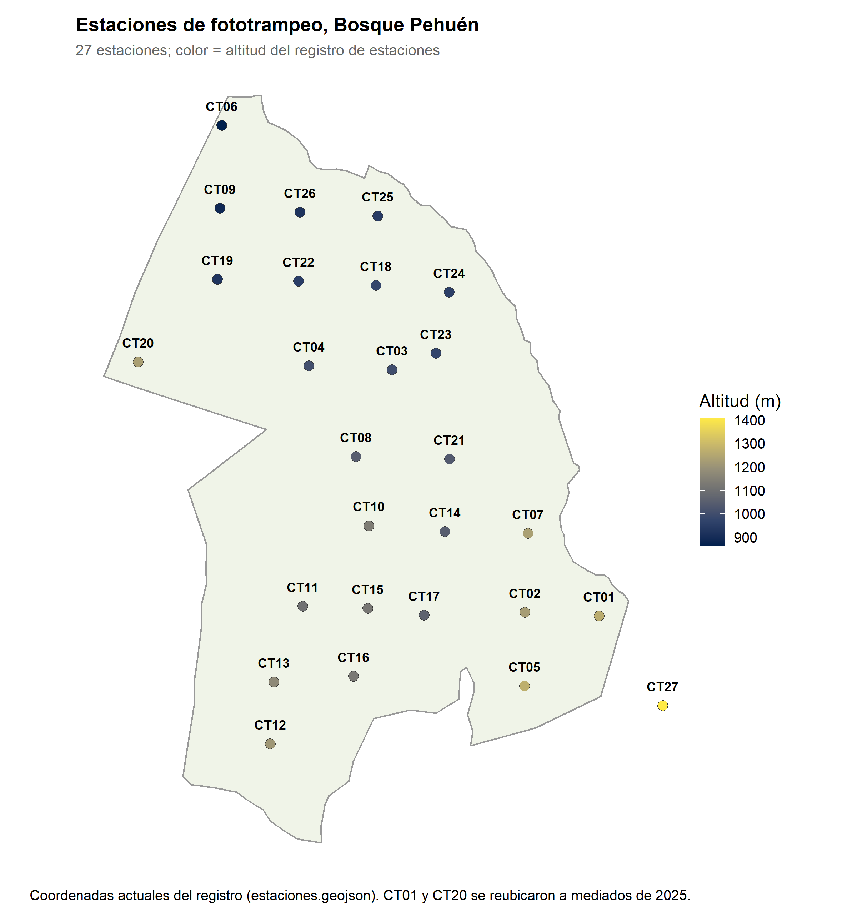

# Resumen

**415 eventos independientes** de seis especies focales (puma, güiña, zorro culpeo, jabalí,
liebre, perro), registrados por **27 cámaras** durante **19 meses**, con **11.823 días-cámara
útiles**. El detalle de cada punto está en el documento completo, en la sección del mismo
número.

| Pregunta | Estado | Lo principal hasta ahora |
|---|---|---|
| (i) Tasas de detección | **Hecho** | La liebre cae fuertemente desde diciembre de 2025 en las estaciones con reloj válido, pero sigue presente en CT18 |
| (ii) Patrones espaciales | **Parcial** | Descriptivo hecho. Ocupación preliminar, todavía no citable |
| (iii) Patrones temporales | **Hecho** | Los nativos coinciden poco en el horario con el perro, en hora del reloj y en hora solar, y resiste todas las pruebas de sensibilidad. El culpeo mantiene su horario respecto del sol todo el año |
| (iv) Espacio y tiempo juntos | **No iniciado** | Principal vacío del proyecto |

---

# 0. Objetivo y preguntas

**Objetivo.** i) Evaluar las tasas de detección, ii) patrones espaciales de actividad y
iii) patrones temporales de actividad de mamíferos nativos e invasores en las cámaras trampa
desplegadas en Bosque Pehuén. Los resultados esperados agregan (iv), la relación entre espacio
y horario.

**Alcance.** Con cámaras fijas e individuos sin marcar no se puede medir **movimiento**. La
**selección de hábitat** requiere describir el hábitat de cada cámara, cosa que aún no se ha
hecho. Por eso (ii) se trata hoy como uso de sitios y distribución.

---

# 1. Los datos

## 1.1 Estaciones

27 estaciones, de 861 a 1.408 m. Las bajas están al norte; las altas, al sureste.

| Estación | m | Estación | m | Estación | m |
|---|---:|---|---:|---|---:|
| CT01 | 1.263 | CT10 | 1.135 | CT19 | 923 |
| CT02 | 1.223 | CT11 | 1.102 | CT20 | 1.231 |
| CT03 | 998 | CT12 | 1.209 | CT21 | 1.037 |
| CT04 | 1.004 | CT13 | 1.172 | CT22 | 951 |
| CT05 | 1.270 | CT14 | 1.048 | CT23 | 974 |
| CT06 | 861 | CT15 | 1.118 | CT24 | 957 |
| CT07 | 1.232 | CT16 | 1.126 | CT25 | 945 |
| CT08 | 1.048 | CT17 | 1.062 | CT26 | 920 |
| CT09 | 886 | CT18 | 978 | CT27 | 1.408 |

**Notas de instalación.**

- **CT27** se instaló el 11 de diciembre de 2025 y queda fuera del polígono de la reserva.
- **CT01** y **CT20** se reubicaron a mediados de 2025.
- **CT09** y **CT19** están a una distancia parecida de las casas de los guardaparques. Se
  tratan juntas como posiblemente sesgadas.
- **Cambios de altura:** CT09 se elevó a unos 2 m el 14 de mayo de 2025 y CT19 el 5 de junio
  de 2025. CT20 se trasladó a un punto abierto junto al sendero el 9 de junio de 2025. En mayo
  de 2026 se elevaron todas las cámaras a 1,5–2 m.

**Concentración.** CT03 y CT09 reúnen el 33 % de los eventos. CT17, CT23 y CT27 nunca
registraron una especie focal con hora válida.

## 1.2 Esfuerzo y contenido

- El registro va del **9 de octubre de 2024 al 15 de mayo de 2026**, en tres campañas. Se
  analiza por **temporada** (siete, calculadas desde la fecha de cada foto), no por campaña.
- **13.598 días-cámara** en total, de los cuales **11.823 son útiles** (fotos con reloj
  confiable). Por temporada van de 438 a 2.292. El arreglo creció de 9 cámaras en primavera
  de 2024 a 27 desde el verano 2025-26.
- **79 despliegues**: 74 con fotos, 4 solo con video y 1 tarjeta fallida.
- **35.807 imágenes**: 86,8 % vacías y 7,0 % con animal (2.522). Todas las imágenes con
  animal fueron revisadas por una persona.
- **Eventos por especie:** zorro culpeo 185, liebre 131, perro 49, jabalí 19, güiña 16 y
  puma 15.

## 1.3 Pérdida de datos por cámara

| Estación | Despliegue | Qué pasó | Fotos focales sin hora | Situación |
|---|---|---|---|---|
| CT15 | ene – jun 2025 | Reinicios del reloj: 14 tramos, algunos sin punto de referencia | Puma 6, culpeo 6, jabalí 1, perro 1 | Recuperable con un testigo por tramo |
| CT16 | ene – jun 2025 y jun 2025 – ene 2026 | Reinicios de fábrica crónicos; tramos internamente contradictorios | Güiña 3 | No recuperable |
| CT17 | jun 2025 – ene 2026 | Reloj rechazado | Ninguna | Sin impacto en las especies focales |
| CT18 | jun 2025 – ene 2026 | Nombre de archivo adelantado 30–31 días respecto de la foto, de forma constante | Liebre 9, perro 2 | Pendiente de revisión |
| CT18 | nov 2025 – may 2026 | Jabalí: registro del reloj contradictorio. Resto: tramos sin punto de referencia | Jabalí 33, culpeo 16, liebre 12, puma 2, perro 2 | Jabalí no recuperable. Con un testigo se fechan 9 liebres, 2 pumas y 7 culpeos |
| CT19 | ene – jun 2025 | Reinicios de fábrica repetidos: 68 tramos de reloj, 8 contradictorios | Liebre 65, perro 2 | Solo recuperable en parte: un testigo por tramo |
| CT21 | feb – jun 2025 | Tarjeta fallida | Todo el período | Perdido; no aporta esfuerzo |
| CT22, CT24, CT25, CT26 | feb – jun 2025 | Grabaron solo video | Todo el período (en video) | Fuera del flujo; recuperable si se procesa el video |
| CT08, CT10, CT13 | otoño 2025 (y CT08 primavera 2025) | Rechazos falsos, corregidos el 3 de noviembre de 2026 | — | **Recuperados** (380 → 415 eventos) |

En total, **249 de 2.522 imágenes con animal (10 %)** no tienen hora confiable. Entre las
focales son **160 de 1.112 (14 %)**, con una pérdida desigual:

| Especie | Fotos sin hora | % de sus fotos | Eventos utilizables | Eventos perdidos |
|---|---:|---:|---:|---:|
| Jabalí | 34 | 23 | 19 | 2–34 |
| Liebre | 86 | 22 | 131 | 11–85 |
| Puma | 8 | 17 | 15 | 3 |
| Güiña | 3 | 10 | 16 | 2–3 |
| Zorro culpeo | 22 | 7 | 185 | 13–21 |
| Perro | 7 | 4 | 49 | 5–7 |

*Los rangos vienen de los tramos con el registro contradictorio, donde solo se sabe que hay
entre 1 evento y uno por foto.*

## 1.4 Tipos de pérdida de datos

| Tipo | Cómo se perdió | Impacto |
|---|---|---|
| Imágenes vacías | Disparos sin animal (31.090 imágenes, 86,8 %) | No es pérdida de información: es el costo normal del método |
| No identificables | Animal o figura que no se puede asignar a especie (521). En otoño 2026, 398, concentradas en CT08 y CT22 | Pérdida menor. Se verificó que no ocultan liebres: en esas estaciones nunca hubo liebre |
| Solo video | Cuatro cámaras grabaron video en su primer despliegue | El período cuenta como esfuerzo de muestreo, pero sus detecciones no entran. Recuperable procesando el video |
| Tarjeta fallida | La tarjeta de CT21 no guardó nada (feb – jun 2025) | Período perdido por completo, sin esfuerzo ni detecciones |
| Reloj coherente sin punto de referencia | El reloj se reinicia (por ejemplo, al cambiar baterías) y sigue avanzando parejo, pero con una fecha equivocada | Las fotos sirven para presencia (ii), no para (i), (iii) ni (iv). Los eventos se cuentan exactos. **Recuperable** con una foto testigo de hora conocida en cada tramo |
| Registro del reloj contradictorio | La fecha del nombre de archivo y la fecha guardada en la imagen no coinciden | **No recuperable**. Sirve solo para presencia, y los eventos quedan como rango |
| Desfase constante del nombre de archivo | El nombre va 30–31 días adelantado respecto de la foto (CT18, jun 2025 – ene 2026) | Pendiente. Requiere una regla nueva antes de decidir si se recupera |
| Rechazo falso del procedimiento | Regla de medianoche demasiado estricta, fecha de visita mal anotada, reloj configurado un mes atrás | **Corregido** el 3 de noviembre de 2026: se recuperaron 4 despliegues, y se pasó de 380 a 415 eventos |
| Cambio de instalación | Altura o ubicación de la cámara modificada (CT09, CT19 y CT20 en 2025; todas en mayo de 2026) | No se pierden datos, pero **se pierde comparabilidad** entre años. Afecta sobre todo a la liebre en CT09 |

---

# 2. Pregunta (i): tasas de detección

**Estado: hecho.**

| Análisis | Qué hace | Cómo lo hace | Hallazgo principal (o qué produciría) | Estado |
|---|---|---|---|---|
| Evento independiente | Convierte fotos en registros | Agrupa fotos de la misma especie y estación separadas por menos de 30 min | 415 eventos. Ejemplo: 579 fotos de vacuno son 19 eventos | Hecho |
| Tasa de detección | Compara especies y temporadas con distinto esfuerzo | Eventos por 100 días-cámara, por especie, estación y temporada | Culpeo estable (1–3). Perro con máximo en el verano 2025-26 (0,61). Puma sin eventos fechados en otoño ni invierno | Hecho |
| Serie de la liebre | Sigue a la liebre estación por estación | Tabla estación × temporada y verificación de artefactos (cámaras activas, fotos no identificables, identificación) | Entre los dos otoños cae de 0,66 a 0,05. Todas las estaciones quedan en silencio desde diciembre de 2025, salvo CT18 (9–11 eventos sin fecha). Parte de la caída se explica por la elevación de CT09 | Hecho; interpretación abierta |
| Altura de cámara como variable | Separa el efecto de la altura del efecto biológico | Covariable en la tasa y en la detección (p) | Diría cuánto de la caída de la liebre es instalación | No hecho; requiere la altura registrada por visita |
| Sensibilidad al umbral | Muestra que el resultado no depende de los 30 min | Repetir con 15, 30 y 60 min | 427 / 415 / 410 eventos. Caída de la liebre entre otoños: 12,7 veces (30 y 60 min), 13,9 (15 min) | Hecho |
| Recuperar fotos sin hora | Devuelve fotos a los análisis con fecha | Fotos testigo de hora conocida por tramo | CT15: 6 pumas. CT18: 9 liebres, 2 pumas, 7 culpeos. CT19: liebres, en parte | Parcial (CT08, CT10 y CT13 hechos) |

**Tres explicaciones posibles para la liebre:** patrón estacional, disminución real o
cambio de sitios. Se distinguen con testigos para CT18, con la confirmación de la visita de
noviembre–diciembre de 2025 y con los datos de invierno y primavera de 2026.

---

# 3. Pregunta (ii): patrones espaciales

**Estado: parcial.**

| Análisis | Qué hace | Cómo lo hace | Hallazgo principal (o qué produciría) | Estado |
|---|---|---|---|---|
| Mapas de presencia y riqueza | Muestra dónde se vio cada especie | Presencia o ausencia y número de especies focales por estación; incluye fotos sin hora | Puma en 8 estaciones | Hecho |
| Mapas de burbujas | Muestra dónde se concentran los registros | Círculo proporcional a los eventos de cada estación | CT03 y CT09 reúnen el 33 % de los eventos | Hecho |
| Ocupación ingenua | Proporción de sitios con la especie | Estaciones con al menos un registro / estaciones muestreando | Culpeo 16–44 % por temporada. Perro hasta 5 estaciones | Hecho |
| Ocupación de una temporada (MacKenzie et al. 2002) | Separa uso del sitio (ψ) de detectabilidad (p) | Historial de detección por ocasiones de 14 días; cálculo propio | Culpeo, invierno 2025: ψ ≈ 0,54, p = 0,20, ingenua 0,40. Perro: ψ 0,41–0,45 con p 0,03–0,08, un resultado que depende más del modelo que de los datos. Puma, güiña y jabalí no se pueden modelar | Preliminar, no citable |
| Largo de la ocasión | Justifica los 14 días | Barrido de 1 a 14 días | ψ estable entre 3 y 14 días (culpeo 0,50–0,54) | Hecho |
| Ocupación con covariables (`unmarked`) | Valores citables y **selección de hábitat** | ψ en función de la altitud y de descriptores de hábitat; esfuerzo en p | Si el uso sube o baja con la cobertura, el tipo de bosque o los senderos | No hecho; requiere descriptores de hábitat |
| Royle–Nichols (liebre) | Corrige una detección desigual entre estaciones | La detección depende de la abundancia local | Ocupación de la liebre sin el sesgo de CT09 | No hecho |
| Actividad humana como covariable | Mide la perturbación por estación | 1.674 imágenes de personas y vehículos | Explicaría la presencia del perro y, en (iv), la nocturnidad de los nativos | No hecho |

**Se excluyen**, con la razón:

- ocupación multiespecie, porque exige cientos de sitios;
- REM y REST, porque no se miden distancias;
- captura–recaptura espacial de güiña, porque exige cámaras cenitales.

---

# 4. Pregunta (iii): patrones temporales

**Estado: hecho** la actividad diaria, el solapamiento, la variación entre temporadas y la
sensibilidad del solapamiento.

| Análisis | Qué hace | Cómo lo hace | Hallazgo principal (o qué produciría) | Estado |
|---|---|---|---|---|
| Curvas de actividad | Describe el horario de cada especie | Densidad de kernel circular (von Mises, paquete `overlap`); mínimo 30 eventos | Culpeo nocturno, con máximo cerca de las 22:00. Liebre crepuscular y nocturna. Perro estrictamente diurno. Güiña, jabalí y puma bajo el umbral | Hecho |
| Hora solar de doble anclaje | Corrige el cambio anual del amanecer y la puesta (2,9 h) | Cada detección se ubica respecto del amanecer y la puesta de su día, en un día de referencia fijo (06:42 / 18:52) | Los picos se afinan. El día de referencia se fijó porque si no la misma detección se movía 42 min | Hecho |
| Solapamiento entre pares | Mide cuánto coinciden dos horarios | Coeficiente Δ1/Δ4 (Ridout y Linkie 2009), 1.000 bootstraps, categorías de Monterroso | Nativos × perro: **Bajo** en ambos marcos (culpeo 0,33; güiña 0,26). Nativos × liebre: alto. Pares con puma: sin conclusión. Con hora solar cambian de categoría 3 de 10 pares, ninguno a la conclusión opuesta | Hecho |
| Variación entre temporadas | Muestra si una especie ajusta su horario en el año | Mitad cálida contra mitad fría, en los dos marcos; solapamiento y prueba de aleatorización | Culpeo: difiere en hora del reloj (p = 0,027) y no en hora solar (p = 0,20); cambia el largo de la noche, no su horario. Liebre: difiere en ambos, pero cada mitad viene de otras estaciones y años; no se puede leer como temporada | Hecho |
| Sensibilidad del solapamiento | Muestra que el resultado no depende de decisiones de análisis | Umbral de 15 y 60 min; sin CT03 ni CT09; sin CT09 ni CT19 (guardaparques); dejar fuera cada una de las 27 estaciones | Nativos × perro: Bajo en todas. Sin guardaparques se separa más (culpeo × perro 0,33 → 0,27). Los pares con puma dependen de una o dos estaciones (CT04) | Hecho |

**Se excluyen** las razones de evitación–atracción, porque el método fue refutado.

---

# 5. Pregunta (iv): espacio y tiempo juntos

**Estado: no iniciado.** Ningún par de especies comparte más de 10 estaciones. Solo tres
pares tienen más de 40 eventos de cada especie en las estaciones que comparten: culpeo ×
liebre (138 / 112), culpeo × perro (140 / 46) y liebre × perro (124 / 46).

| Análisis | Qué hace | Cómo lo hace | Hallazgo principal (o qué produciría) | Estado |
|---|---|---|---|---|
| Actividad según el sitio | Muestra si el perro cambia el horario de los nativos | Curva del culpeo en estaciones con y sin perro (o según la actividad humana) | Si el culpeo es más nocturno donde hay perros, hay indicio de desplazamiento | No hecho |
| Tiempo entre encuentros | Muestra si una especie evita el sitio que otra acaba de usar | Tiempo del perro al culpeo en estaciones compartidas, contra un azar construido por permutación (Niedballa et al. 2019) | Distingue evitación de simple separación de horarios | No hecho; poder bajo |
| Sensibilidad sin CT03 ni CT09 | Muestra si dos estaciones sostienen el resultado | Repetir el solapamiento excluyéndolas, y dejando fuera cada estación | Nativos × perro sigue Bajo (sección 4) | Hecho |

---

# 6. Lo que todavía no podemos afirmar

- Que los nativos **evitan** al perro. Hoy solo se muestra una separación de horarios.
- Que la liebre ocupa menos territorio que el culpeo.
- Ningún valor de ψ, hasta reajustarlo con errores estándar.
- Que la liebre cambie de horario entre temporadas: sus dos mitades del año vienen de
  estaciones y años distintos.
- Nada sobre puma, güiña ni jabalí más allá de su presencia.
- Que la caída de la liebre sea una disminución. Tampoco que la liebre haya desaparecido:
  CT18 la sigue registrando.

**Decisión pendiente del equipo:** si el marco solar será el principal o el de sensibilidad, y
qué día de referencia se usa (el promedio del sitio o el equinoccial).

---

# 7. Tareas de terreno

- Confirmar que en la visita de noviembre–diciembre de 2025 no se movió ninguna cámara.
- Preguntar a los guardaparques por controles de liebre o animales muertos.
- Revisar la liebre en cuanto llegue la campaña de invierno de 2026.
- Buscar fotos testigo para CT18 (la más urgente), CT15 y CT19.
- Registrar la altura de cada cámara en cada visita.
- Levantar descriptores de hábitat por cámara.

---

# 8. Prioridades

| # | Qué | Pregunta |
|---:|---|---|
| 1 | Ocupación con covariables (`unmarked`, Royle–Nichols) | (ii) |
| 2 | Prueba de si el perro desplaza a los nativos | (iv) |
| 3 | Seguimiento de la liebre | (i) |
| 4 | Recuperar fotos sin hora | (i), (iii) |
| 5 | ~~Cambios de actividad entre temporadas~~ **Hecho** | (iii) |
| 6 | Imágenes de personas y vehículos | (ii), (iv) |
| 7 | Altura de cámara como variable | (i) |
| 8 | ~~Análisis de sensibilidad~~ **Hecho** | todas |
